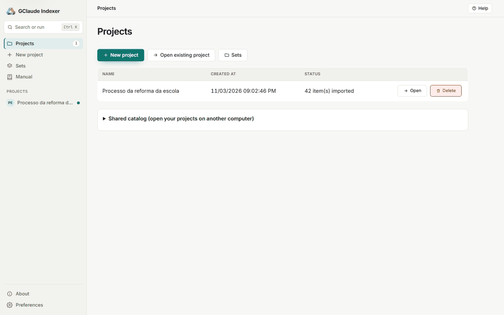
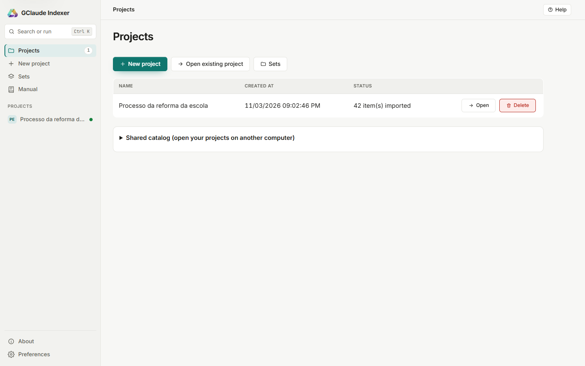
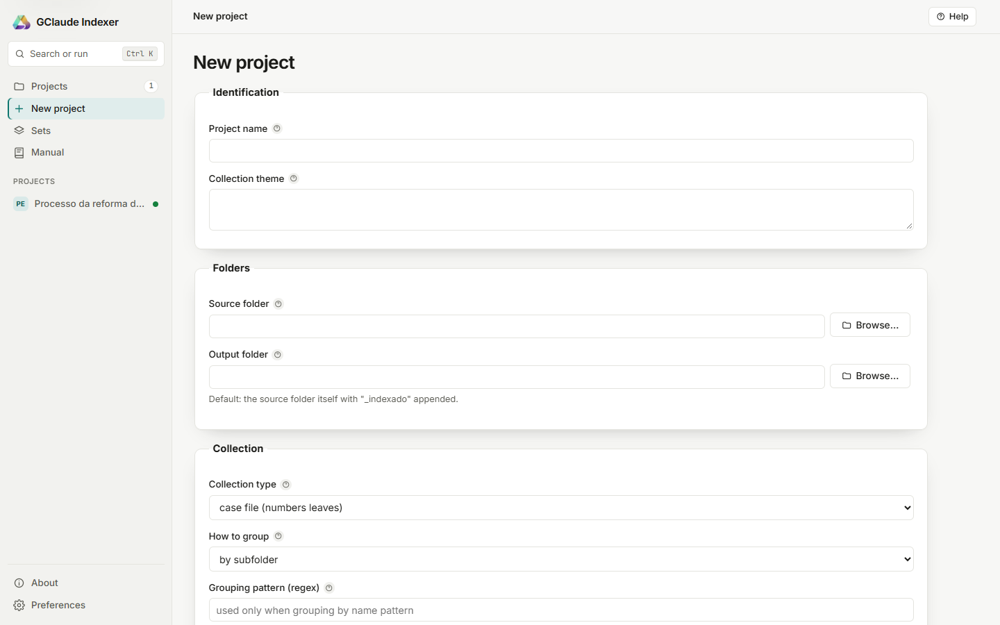
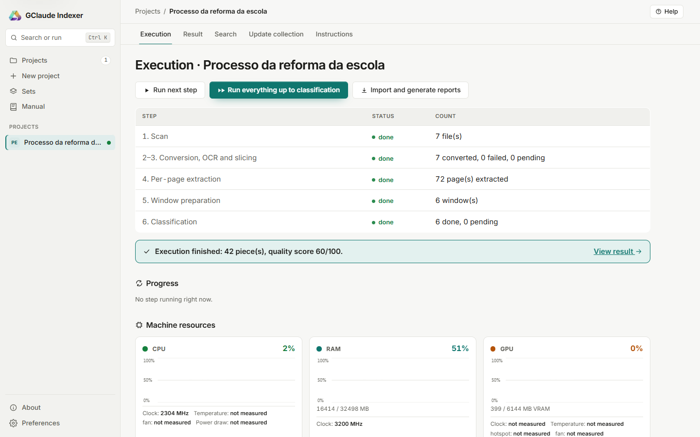
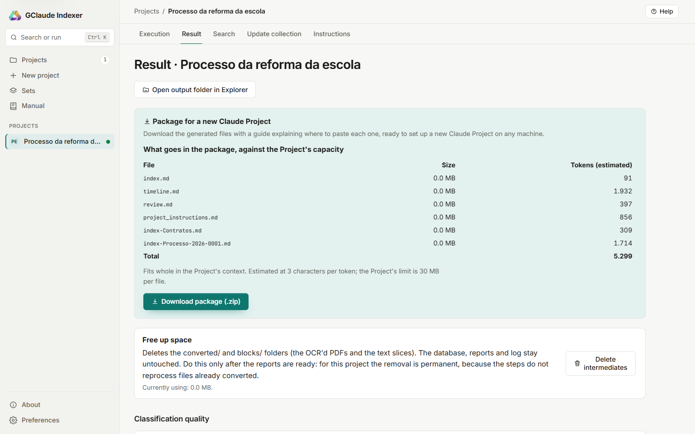
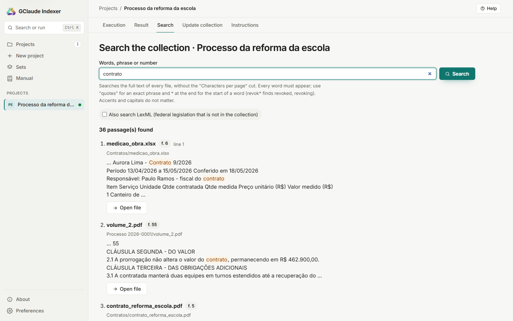
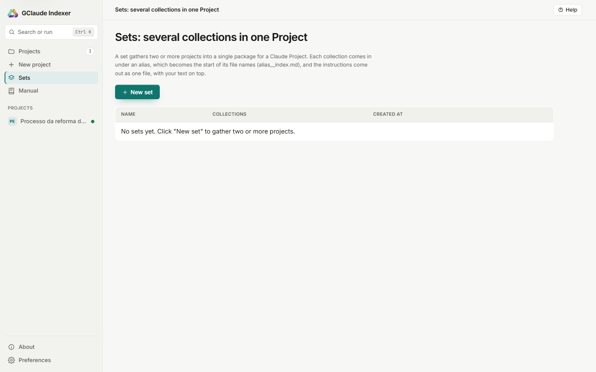
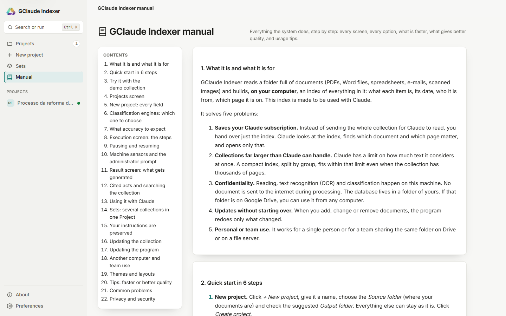

**Read this in your language:** **[Português (Brasil)](docs/README.pt-BR.md)** · **[Español](docs/README.es.md)** · English (you are here)

# GClaude Indexer

 

GClaude Indexer reads a folder full of documents on your Windows PC (PDFs, scans, Word, Excel, e-mails) and builds a small index of everything in it: what each item is, its date, who it is from and which page it is on. You give Claude only that index. Nothing leaves your computer while the collection is read.

*A short tour of the Workspace layout (1.10.0): the projects in the side bar, the tabs of a project, the command palette (Ctrl+K) taking you to the search, and the dark Studio theme.*

## Three people who use it

**A lawyer with a 3,000-page case file.** She asks Claude "when was the expert report filed?". Claude looks in the index, finds the item, the sheet and the file, and opens only that document. Without the index, she would have to send all 3,000 pages, and Claude does not accept that much at once.

**A clerk who handles administrative proceedings.** The folder grows every week. He opens the program, sees the notice "14 new, 3 changed, 1 removed", confirms, and only that part is reread. The index stays current and the old conversations with Claude remain valid, unless a document was added to or removed from the middle of the case file and changed the numbering of the sheets after it.

**An office with three collections.** Contracts, minutes and correspondence live in separate projects. On the Sets screen, the three become a single package, and one Claude Project answers "which collection has the 2019 amendment?" and goes straight to the right file.

## What you get

A few small text files in the output folder you chose:

- `index.md`: the summary, with one index per group of documents beside it (`index-<grupo>.md`). Each item with type, date, author, file and page.
- `timeline.md`: the items in date order.
- `normas-citadas.md`: the laws and other acts cited in the collection, with a link to the text of each one.
- `review.md`: what was read, what failed and what was removed from the folder.
- `project_instructions.md`: the instructions ready to paste into the Claude Project, the area of claude.ai that keeps instructions and files for every conversation about one subject.
- `buscar.bat`: the topic search for whoever uses Claude Code, the version of Claude that runs in a command window on your computer and reads files straight from disk.

And a `.zip` package with the index files, measured before you download: the program shows how many tokens the package will take in the Project and warns when a file would be too large. A token is Claude's unit of text: three or four letters, on average.

*Projects: every collection this computer knows.*

*New project: usually the name and the source folder are enough; the program proposes the rest from what it finds in the folder.*

*Run: the steps with progress, the log in plain language and the CPU, memory and graphics card sensors.*

*Result: quality score, pending items, a preview of each file and the package for Claude with the token budget.*

*Search the collection: the term, the file, the page and the excerpt; the LexML query is optional.*

*Sets: several collections in a single Claude Project.*

*Manual: every screen and every option explained inside the program.*

## What you need to have

- Windows 10 or 11.
- A few gigabytes of free disk.
- Nothing to install beforehand. The installer brings Python, the OCR (Tesseract and Ghostscript, which read scanned pages), Ollama, the program that runs the local model, and the model itself; what is optional, it shows in a list before downloading. The internet is used only then.
- A graphics card with 6 GB or more makes the local model much faster. Without a card, it runs slowly in ordinary memory, and the rules engine does the job in seconds.

The program classifies the items in two ways. The rules engine recognizes each item by patterns in the text, such as the titles of the items, and finishes in seconds. The local model is an artificial intelligence program that reads each passage, gets the date and the author right more often, and takes longer. The default option, Automatic, uses the local model when the computer can handle it and the rules when it cannot.

To install, download `GClaude-Indexer-Setup-1.10.3.exe` from the [latest release](https://github.com/alexccastilho/gclaude-indexer/releases/latest) and double-click it. Windows will show a SmartScreen warning, because the installer has no paid digital signature: click "More info" and then "Run anyway". On the Dependencies page, the installer lists what it will download and install alongside; leave everything checked. The largest item is the local model, about 3 GB, downloaded once only. The CPU temperature reader item asks for Windows administrator permission; you can accept. When it finishes, the program opens a page in your browser, at `http://127.0.0.1:8000`, and the desktop shortcut does the same the next times. To update, install the new version on top; your projects stay where they are. To uninstall, use Settings > Apps: it asks what to remove and never deletes your projects.

Whoever cannot install programs on the machine, or wants to run from the source code, has the full path in [docs/TECHNICAL.md](docs/TECHNICAL.md).

## Ten minutes to try it

You do not need a collection of your own. The repository's `demo/acervo` folder is a small, entirely made-up collection: 72 pages and 41 items, with two volumes of a case file in PDF, a contract, a memo in Word, a spreadsheet, a scanned letter and an e-mail. The file `demo/gabarito.csv` says what each page is. The installer does not bring that folder: on the project's GitHub page, click the green **Code** button, then **Download ZIP**, and unpack the file into a folder of yours.

1. Open the program and click **New project**. Give it a name and point the source folder at `demo/acervo`. Under **Included extensions**, check PDF, Word, Excel, images and e-mail. Click **Create project**.
2. On the Run screen, click **Run everything up to classification**. With the rules engine it takes seconds; with the local model, a few minutes.
3. When it finishes, click **Import and generate reports** and open the **Result** screen.
4. Click **Download package (.zip)**. In claude.ai, create a Project, paste the whole content of `project_instructions.md` into the instructions field and upload the other files as project knowledge. The `.zip` brings a step-by-step guide with these steps.
5. Ask Claude: "what is the contract amount and who signed it?". It finds the item in the index and asks for the original file only if it needs the exact text.

On every screen, the **Help** button summarizes the screen and the **?** next to each field explains the field.

## How accurate it is

The index is measured against the demo collection's answer key at every version that touches the classifier, and an automatic test on GitHub repeats the measurement at every code change. In the last measurement (02/11/2026), no page was lost with either engine. The rules engine found 36 of the 41 items in 4 seconds and got the type right for 94% of them, but the date for only half of them and the author for only one in five. The local model (`qwen3.5:9b`) took 4 minutes, got the date right for 89% and the author for 84% of the items found, and sliced more items than it should.

What that means in practice: every page of the collection is in the index, even when the type or the date come out wrong, and Claude checks the text in the original document before answering; that is what the instructions tell it to do. The full numbers, what each one means and what they do not say are in [docs/QUALITY.md](docs/QUALITY.md).

## Privacy

- The documents are read, go through OCR and are classified only on your computer. During processing, no document, page or file name is sent over the network. The local model talks only to the Ollama on the same machine.
- The program listens only on your own machine (`127.0.0.1`) and accepts requests only from its own screens: a website open in the browser cannot give it orders.
- The source folder is never changed. Everything the program produces goes to the output folder.
- The project database (`project.db`) holds the text of the pages. If the collection has personal data, protect the output folder as you would protect the documents, including on Google Drive.
- Content reaches Claude only when you send it: when you upload the index files to a Project, when you send a document, or when you choose the optional `claude_code` engine. The only external query is the LexML search, which sends only the term you typed: on the screen, only with the box checked; in `buscar.bat`, also when no act in the collection cites the term.

## Several collections in one Project

Each project is one collection. When the question spans several ("what do we have on supplier X in contracts and in minutes?"), the **Sets** screen joins two or more projects into a single package. Each collection gets a short alias, each file carries the alias in its name, and a single `project_instructions.md` tells Claude which collection to look in for each thing. The **Write to the folder** button does the same for Claude Code, with a `CLAUDE.md` that points to each collection. A collection whose folder is not reachable on this computer stays out, with the reason on screen, and comes back on its own when the folder returns.

## Legislation and search

Pages of laws, decrees and ordinances saved from the Planalto site are recognized by the page's own structure, with no model. Each norm cited in the collection becomes a line in `normas-citadas.md`, with the number, the date, the summary, where it appears and a link to the text on LexML, the Senate's legislation portal. Claude does not need the text of the law inside the Project: it opens the link when it needs it.

The **Search the collection** screen looks for a word or phrase in the text of every page and shows the file, the page and the excerpt. An optional box also queries LexML to list the norms that deal with the topic. Whoever uses Claude Code has the same search on the command line, through the `buscar.bat` that sits in the output folder.

## As a team

Put the output folder on Google Drive or on a network folder, and any computer with access opens the same project. On the Projects screen, point the **Shared catalog** at a Drive folder and every computer sees the same list. An open project is locked to that computer; the other one is told. When switching computers, close the program on the first one and wait for Drive to finish syncing before opening on the second.

## Manual and help

The **Manual** menu, at the top of any screen, covers every screen and every option, what is faster and what gives more quality, how to use the results with Claude and with Claude Code, team use and common problems. It is in Portuguese, English and Spanish.

For whoever installs and maintains: [docs/TECHNICAL.md](docs/TECHNICAL.md) has the requirements in detail, the installation without the installer, what each output file contains, the variables the installer writes for Ollama and the troubleshooting. What changed in each version is in [CHANGELOG.md](CHANGELOG.md). To contribute, read [CONTRIBUTING.md](CONTRIBUTING.md); to report a security flaw, [SECURITY.md](SECURITY.md).

## License

GClaude Indexer is licensed under the **GNU General Public License v3.0** (GPL-3.0); see [LICENSE](LICENSE). You are free to use, study, modify and redistribute this software, including commercially, as long as any modified version you distribute is also licensed under the GPL-3.0, with the source code available. There is no warranty of any kind.
