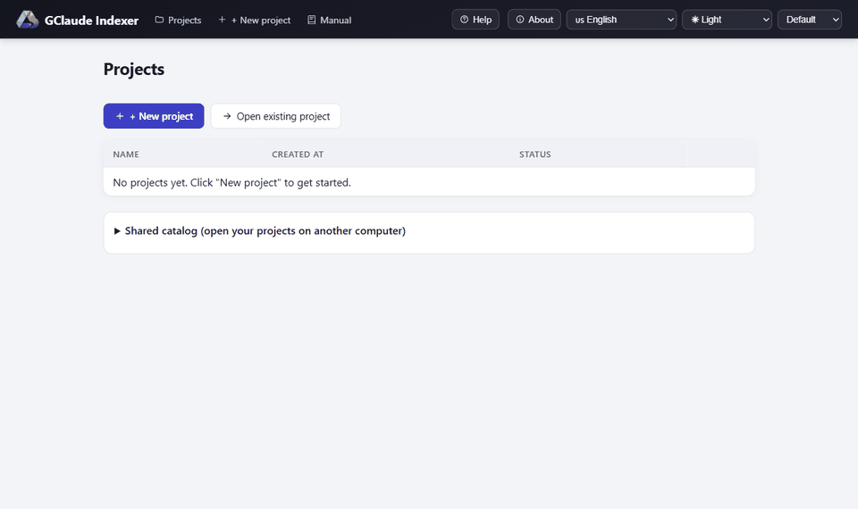
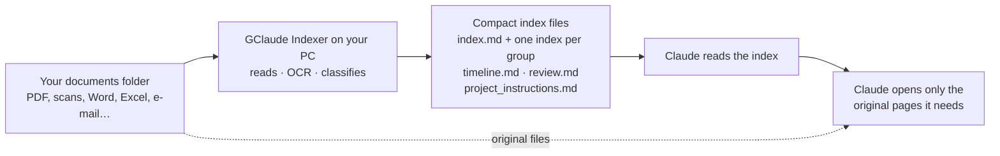
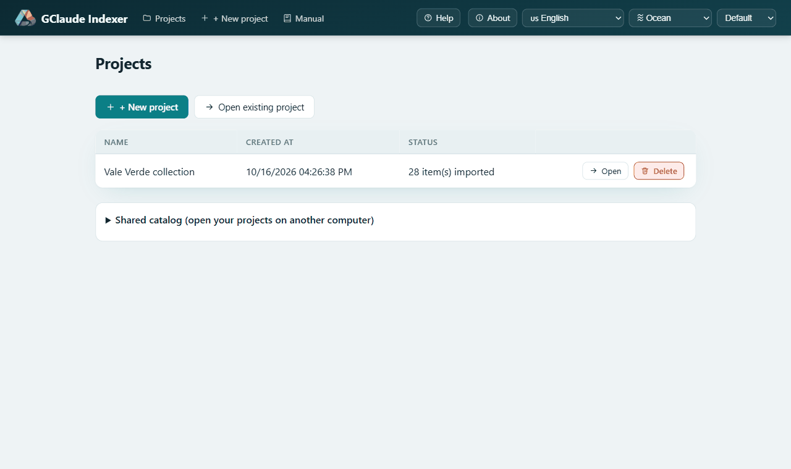
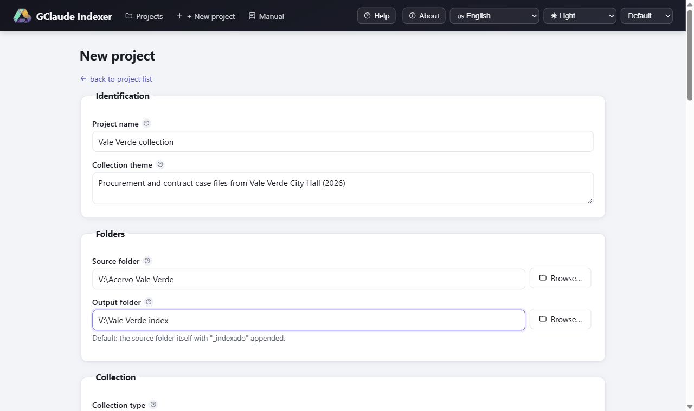
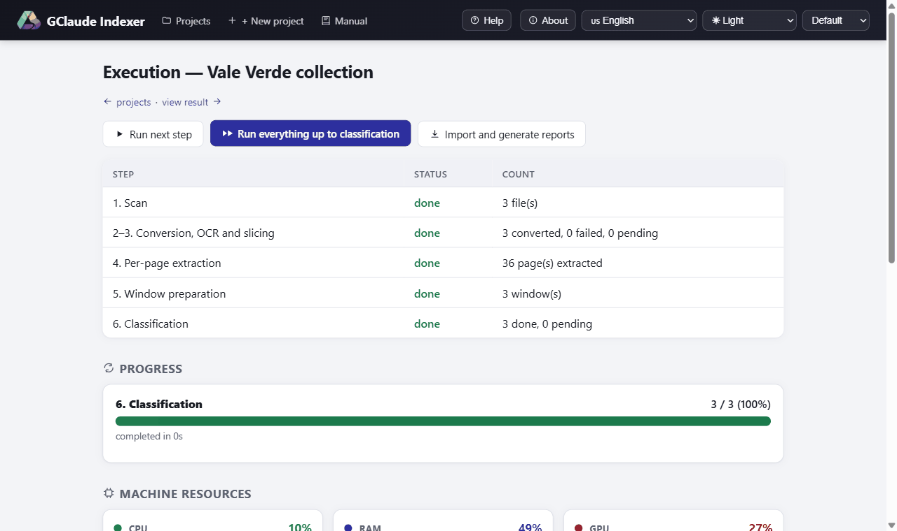
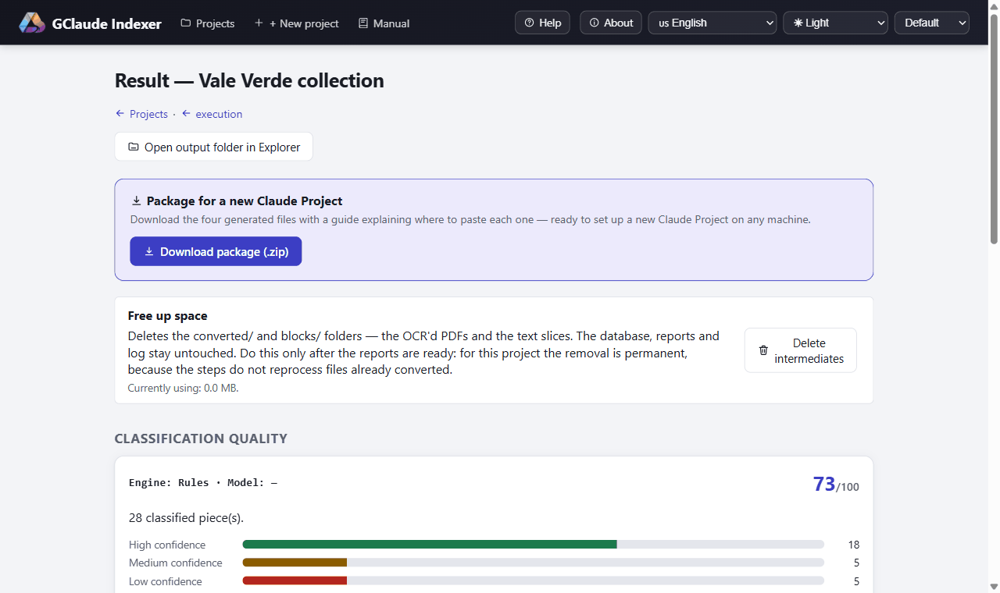
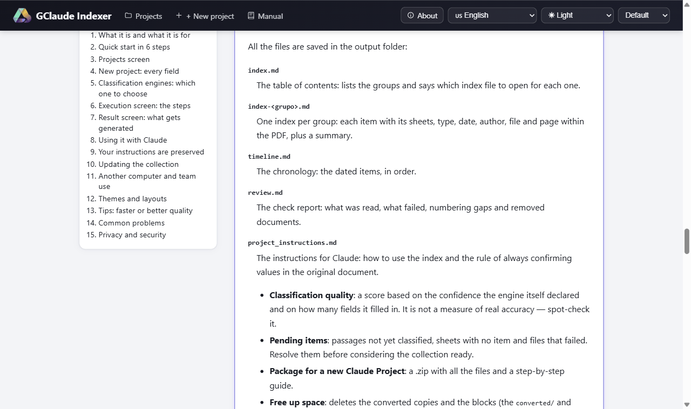

**Read this in your language:** **[Português (Brasil)](docs/README.pt-BR.md)** · **[Español](docs/README.es.md)** · English (you are here)

# GClaude Indexer

GClaude Indexer reads a folder full of documents on your own Windows PC
(PDFs, scans, Word, Excel, e-mails and more) and builds a small, organized
index of everything in it: what each item is, its date, who it is from and
which page it is on. You then give Claude that index instead of the whole
pile of documents. It is made for anyone who works with large collections
of documents and uses Claude: lawyers, accountants, researchers, public
offices, small companies.



*A short tour of the app.*

## What it is for

**1. Spend less of your paid Claude subscription.** Claude counts every
page you make it read. With GClaude Indexer, Claude reads a compact index
first, finds which document and which page answer your question, and opens
only those. Example: a lawyer with a 3,000-page case file asks "when was the
expert report filed?". Claude looks it up in the index and opens one
document, not all 3,000 pages.

**2. Work with far more documents than Claude can hold at once.** Claude
has a limit on how much text it can consider at the same time. A large
collection does not fit, but its index does: it is split into one small
file per group, so even thousands of pages turn into something Claude can
browse. The full text stays on your side, ready to be opened page by page.

**3. Your data stays with you.** Reading, text recognition (OCR) and
classification all happen on your computer. Nothing is sent anywhere while
the collection is processed. The result is a local database plus a few
text files, kept in a folder you choose. If that folder is on Google
Drive, you can open the same project from any computer signed into that
Drive.

**4. Keep the index up to date without starting over.** Collections grow.
When you add, change or remove documents, the app finds what changed and
redoes only that part. It shows you the plan and the cost before it touches
anything.

**5. Easy for one person or a whole office.** One person can use it on a
laptop. A team can keep the projects in a shared Drive folder or on a file
server. Example: an office team shares a Drive folder of client files; one
colleague updates the index in the morning, another opens the same project
in the afternoon on a different PC.

## How it works in one minute



1. You point the app at a folder of documents. It never changes that
   folder; it only reads it.
2. On your PC, it turns every page into text (using OCR for scans), then
   works out where each document starts and ends, its type, date, author
   and a short summary.
3. It writes a few small Markdown files: a table of contents (`index.md`),
   one index per group of documents, a timeline, a review report and
   ready-made instructions for Claude.
4. You give those files to Claude. When it needs details, it opens just the
   original page the index points to.

To give you an idea of time: a real collection of about 2,900 pages took a
little over 5 hours with the local model on an ordinary graphics card.
With the rules engine, it takes minutes.

## Screenshots



*Projects: every collection this computer knows, plus the shared catalog that lets another computer open the same projects.*



*New project: folders, file types, OCR language and classification engine on one screen; usually only the name and the source folder need filling in.*



*Execution: the steps with live progress, CPU/RAM/GPU graphs and a log written in plain language.*



*Result: quality score, pending items, a preview of each generated file and the package for Claude.*



*Manual: every screen and option explained inside the app, in your language.*

## What's new in 1.4

- **Instructions you already have are kept.** What the app writes in
  `project_instructions.md` and `CLAUDE.md` now sits between two markers
  (`GCLAUDE-INDEXER:BEGIN` and `GCLAUDE-INDEXER:END`). Only that block is
  rewritten; everything else in the file is yours and stays. The first time,
  a `.bak` copy of your original file is saved. A new field on the New
  project form, **Instructions you already use**, puts your existing
  instructions at the top of the file.
- **Safer handling of removed files.** If a removed document had an
  identical copy in the folder, the copy is indexed in its place. When
  removing a document from the middle of a case file changes the sheet
  numbers of the documents after it, you are warned on the confirmation
  screen and in the log. The removed file's converted copy is cleaned up,
  and indexes of groups that no longer exist are deleted.
- **A full manual inside the app.** The **Manual** menu explains every
  screen and option, in English, Portuguese and Spanish.
- **A live log in plain language.** Messages say what happened and what to
  do; technical details only appear in parentheses at the end.
- **Four new themes** (Aurora, Gown, Graphite and Ocean) and smooth motion
  between screens, switched off automatically when Windows asks for reduced
  motion.
- **Security hardening.** The app only accepts requests from its own
  screens (protection against CSRF and DNS rebinding), so a website open in
  your browser cannot give it orders. Deleting a project removes only what
  the app created. The instructions for the Claude Code engine treat
  document text as untrusted data. Calls to the local model never go
  through a proxy. FastAPI and Starlette were updated.
- **Faster screens.** Lighter progress checks and new database indexes.

## Install

### What you need

- **Windows 10 or 11.** The app only runs on Windows (details under
  *Technical details* below).
- A few gigabytes of free disk space.
- Everything else (Python 3.12, Tesseract, Ghostscript, Ollama and the
  local model) is installed for you.
- A graphics card (GPU) with a few gigabytes of memory makes the local
  model much faster, but it is not required. The default model
  (`qwen3.5:4b`) is about a 3.2 GB download and fits a 6 GB card as well as
  an 8 GB one. If the machine has too little memory, the app switches to
  the `rules` engine on its own and tells you why.

### The easy way: the Windows installer

1. Download `GClaude-Indexer-Setup-1.5.8.exe` from the
   [latest release](https://github.com/alexccastilho/gclaude-indexer/releases/latest).
2. Double-click it. It asks whether to install just for you or for everyone
   on the machine, shows the licence and lets you tick which dependencies to
   fetch.
3. It downloads and installs all of them (Python 3.12, Tesseract with the
   Portuguese language data, Ghostscript, Ollama and the classification
   model) with a progress bar and no terminal window.

**Windows SmartScreen will warn you.** The installer is not code-signed,
because a certificate costs money this project does not have. Click
"More info" and then "Run anyway". It is good practice to check the file
you downloaded against the SHA-256 published with each release.

**About Ollama.** Ollama is the free program that runs the local model on
your own machine. The installer installs it and the default model when you
accept. You can skip it: the `rules` engine needs nothing extra.

**Uninstalling.** Use Settings > Apps, like any other program. It asks, one
by one, which shared dependencies should go with it. It never deletes your
projects.

You do not need Git, a GitHub account or programming experience. If you
cannot install programs on the machine, see *Installing without the
installer* under Technical details.

### Quick start in 6 steps

1. **New project.** Click **+ New project**, give it a name, choose the
   **Source folder** (where your documents are) and check the suggested
   **Output folder**. The rest can stay as it is. Click **Create project**.
2. **Run everything.** On the Execution screen, click **Run everything up to
   classification**. You can leave it running and do something else.
3. **Generate the reports.** When classification finishes, click **Import
   and generate reports**.
4. **Check the result.** The **Result** screen shows the quality score, any
   pending items and a preview of each file.
5. **Download the package.** Under **Package for a new Claude Project**,
   click **Download package (.zip)**.
6. **Use it in Claude.** On claude.ai, create a Project, paste the whole
   contents of `project_instructions.md` into its instructions and upload
   the other files as project knowledge. When you need the exact content of
   an item, send Claude only the original document the index points to.

On every screen, the **Help** button gives a summary of that screen, and
the **?** next to each field explains it.

## Personal or corporate use

- **Output folder on Google Drive or a file server.** Each project lives
  entirely in its output folder. Put it on Drive or on a network share and
  any computer with access can open it.
- **Shared catalog.** On the Projects screen, point **Shared catalog** at a
  folder inside your Drive. Every computer signed into that Drive then sees
  the same list of projects. Without it, the list stays on each machine,
  even though the projects themselves sync.
- **One computer at a time.** While a project is open, it is locked to that
  computer. Another computer is told who is using it. The lock expires on
  its own after a while without use.
- **Golden rule when switching computers:** close the program on the first
  one, wait for Google Drive to finish syncing, and only then open it on
  the second. The app warns about incomplete syncs, but it cannot replace
  waiting.

## Privacy and security

- Documents are read and classified **only on your computer**. During
  processing, no document, page of text or even file name is sent over the
  network. The local engine talks only to Ollama on the same machine
  (`http://127.0.0.1:11434`), never through a proxy.
- The app's server listens only on `127.0.0.1` (your own machine) and is
  never reachable from the network. It accepts requests only from its own
  screens: a website open in your browser cannot give it orders.
- The source folder is **never modified**. Everything the app produces goes
  into the separate output folder.
- **The project database (`project.db`) stores the text of the pages.** If
  the collection contains personal data (for example under Brazil's LGPD or
  the GDPR), protect the output folder as you would protect the documents
  themselves, including on Google Drive.
- Content reaches Claude **only when you send it**: when you upload the
  index files or a document to a Claude Project, or when you choose the
  optional `claude_code` engine. That content then goes through your Claude
  account, under the terms of your plan.

## Full manual

Open the **Manual** menu at the top of any screen in the app. It covers
every screen and every option, which settings are faster and which give
better quality, how to use the results with Claude, team use, common
problems and tips. It is available in English, Portuguese and Spanish.

## Technical details

Click a topic to expand it.

<details>
<summary><strong>Requirements in detail</strong></summary>

- **Windows 10 or 11, required.** The app talks directly to
  Windows-specific interfaces: PowerShell, WMI (hardware detection and
  resource monitoring), the Windows registry (Tesseract data location and
  locale detection) and Performance Counters (live CPU/GPU graphs). It does
  not run on Linux or macOS.
- **Python 3.12**, installed for you if missing. This project pins
  dependency versions that newer Pythons (3.13, 3.14) break, so the
  installer looks for 3.12 and, if the machine does not have it, downloads
  and installs the official 3.12.10 for the current user: no administrator,
  no manual step, and any other Python already on the machine is left
  exactly where it is.
- **OCR** (scanned documents with no text layer) needs Tesseract and
  Ghostscript. The installer installs both when possible.
- **The `local` engine** (the recommended default) needs
  [Ollama](https://ollama.com), installed by the installer when you accept.
  A GPU with a few gigabytes of free VRAM speeds it up a lot but is not
  required: Ollama uses as much GPU memory as fits and spills the rest into
  system RAM. The default model (`qwen3.5:4b`) is about 3.2 GB to download
  and needs somewhat more than that in combined VRAM + RAM to run. A machine
  with too little of both falls back to the `rules` engine automatically,
  with an explanation on screen.
- **The `rules` engine** needs none of the above: it runs on any Windows
  machine that can run Python, with no GPU, no download and no extra
  software.
- A few gigabytes of free disk space for the Python environment and, if you
  use it, the Ollama model.
- The interface is in English, Brazilian Portuguese and Spanish, chosen
  from a menu in the page header. The default follows your Windows display
  language.
- The installer is a convenience for the first setup. The app itself is not
  compiled into a single `.exe`: it stays as plain, readable Python and
  PowerShell scripts, and a desktop shortcut opens it with a double-click.

</details>

<details>
<summary><strong>Installing without the installer</strong></summary>

This path also works on a machine where you cannot install programs. In
short: run `Indexer.bat` and follow the instructions. Step by step:

**1. Get the source code onto your machine.** If you downloaded the project
as a `.zip`, right-click it, choose "Extract All…" and pick a regular folder
(for example in Documents, or a Google Drive folder mounted with a drive
letter). If you cloned it with Git, you already have a folder. Either way,
remember where it is; below it is called "the project folder".

**2. Open PowerShell in the project folder.** In File Explorer, open the
project folder, then either hold **Shift**, right-click an empty spot and
choose "Open PowerShell window here" (or "Open in Terminal"), or click the
address bar, type `powershell` and press Enter. A blue or dark window opens,
already "in" the project folder.

**3. You do not have to install Python yourself.** The installer in step 4
does it: it needs Python 3.12 specifically, and if your machine does not
have it, it downloads the official 3.12 from python.org (exact version,
checksum verified) into your own user folder. No administrator rights are
needed for that. It is installed *beside* any other Python you have: if
`python --version` prints 3.13 or 3.14 today, it still will afterwards, and
your file associations and Start Menu are left as they are. If you prefer
to install it yourself first, this is the same thing the installer does:

```powershell
winget install --id Python.Python.3.12 -e --scope user --silent --accept-package-agreements --accept-source-agreements
```

**4. Run the installer once.** It installs Python 3.12 if missing, creates
a private Python environment for this app (outside the project folder, so
it survives being moved or re-synced by Google Drive/OneDrive), installs
the Python packages, checks for Tesseract and Ghostscript (installing them
if missing and you agree) and offers a desktop shortcut.

```powershell
powershell -ExecutionPolicy Bypass -File install.ps1
```

Windows may show "Windows protected your PC" the first time you run a
PowerShell script downloaded from the internet. That is normal: the
`-ExecutionPolicy Bypass` flag runs this one script without changing any
permanent setting. The installer shows its progress and asks before
installing anything (Tesseract, Ghostscript and, optionally, Ollama and its
default model, which is a large download). If a step fails, it prints the
manual command to run instead. The first run can take several minutes,
mostly downloading packages.

**5. Accept the desktop shortcut** at the end if you want one; it is the
easiest way to open the app. A *second*, optional shortcut, "GClaude
Indexer (CPU sensor)", is offered too: say yes only if you want CPU
temperature and power draw on the Execution screen (see *The optional CPU
sensor*). You can change your mind later with
`install.ps1 -CpuSensorShortcut`.

</details>

<details>
<summary><strong>Running day to day</strong></summary>

Double-click the desktop shortcut. A console window appears only the first
time, if the installer still needs to run; after that the app starts with
no visible window and opens your browser at:

```
http://127.0.0.1:8000
```

The server only listens on `127.0.0.1`, your own machine, and is never
reachable from the network or from another computer.

Without the shortcut, from the project folder:

```powershell
python launcher.py
```

This checks the environment and installs anything missing before starting
the server, so it also works as a "just make it work" command on a machine
where you have not run the installer yet.

To close the app, close the terminal window it opened (or, if it runs
hidden via the shortcut, end `pythonw.exe` in Task Manager).

</details>

<details>
<summary><strong>The optional CPU sensor</strong></summary>

The "GClaude Indexer (CPU sensor)" shortcut raises a Windows administrator
prompt every time you open the app, because CPU temperature and power draw
can only be read with administrator rights. What is elevated is *not* the
app: it is one small helper process that only reads the sensors and hands
the numbers back. The server, the indexing and your documents run without
any privileges, and the helper closes together with the app.

Answering **No** is safe and costs nothing else: the app opens exactly as
from the ordinary shortcut, showing GPU temperature, power and clock, and
"not measured" for the two CPU sensors. Nothing fails and no error is
shown. Everything else, including the GPU readings, works without this
shortcut.

</details>

<details>
<summary><strong>Uninstalling in detail</strong></summary>

If you installed with the Windows installer, use Settings > Apps.

Otherwise, double-click `Desinstalar.bat` in the project folder (the same
folder as `Indexer.bat`), or from a prompt:

```powershell
.\Desinstalar.bat
powershell -ExecutionPolicy Bypass -File uninstall.ps1
```

**Why not just `.\uninstall.ps1`?** Google Drive marks every file it syncs
as coming from the internet, and Windows' default execution policy
(RemoteSigned) refuses to run such a `.ps1` without a digital signature
("the file is not digitally signed"). Nothing is wrong with the script:
`Desinstalar.bat` passes `-ExecutionPolicy Bypass` for that one run, like
every other launcher in this project. Running `install.ps1` also clears the
mark from this folder's scripts, so the direct command works after that.

It asks about each item separately, defaulting to **no** every time. It
separates what this installation owns (the virtual environment, the
shortcuts, the sensor libraries, local settings, the PATH entries and
environment variables it added) from the ordinary programs it merely
installed for you: Tesseract, Ghostscript, Ollama, Python and the
downloaded Ollama models. Other software may be using those, so each is
offered on its own, and it says so plainly.

**It never deletes your projects.** The output folders, their databases,
the OCR'd PDFs and the generated reports are your documents, not
installation leftovers. The script lists where they are, with their sizes,
and leaves the decision to you.

Three switches cover the non-interactive cases:

```powershell
powershell -ExecutionPolicy Bypass -File uninstall.ps1 -WhatIfOnly        # show the plan, remove nothing
powershell -ExecutionPolicy Bypass -File uninstall.ps1 -KeepDependencies  # keep Tesseract, Ghostscript, Ollama, Python
powershell -ExecutionPolicy Bypass -File uninstall.ps1 -RemoveAll         # say yes to everything (still not your projects)
```

The project folder itself, if it is synced by Google Drive, is never
touched: delete it there if you want it gone from every computer.

</details>

<details>
<summary><strong>The screens of the app</strong></summary>

The interface has five screens, plus **Manual** and **About**:

1. **Projects**: every project this computer knows, with its creation date
   and status. This is where the app opens.
   - **Shared catalog**: point it at a folder inside Google Drive and every
     computer signed into that Drive sees, opens, edits and deletes the
     same projects. Without it, the project *list* stays on this machine
     even though the projects sync, which is why a second computer would
     otherwise show an empty screen. Projects stored on another computer's
     local disk are listed and marked as out of reach.
   - **Open existing project** takes a folder you point at and reopens the
     project inside it: after a reinstall, on a new machine, for a folder
     you moved or one someone sent you. Nothing is recreated; the output
     folder already holds the whole project.
   - **Delete** offers two choices: only remove the project from the list
     (files stay on disk), or also delete the generated files. In that case
     the app deletes only what it created itself (database, converted
     copies, reports). Your own files in the output folder are kept, and
     the folder is removed only if it ends up empty. In
     `project_instructions.md` and `CLAUDE.md` only the generated block is
     removed. The source folder is never touched.
2. **New project**: a form for the source folder (the documents), the
   output folder (where results go), which file types to include, how
   documents are grouped and which classification engine to use. Every
   field has a sensible default and a "?" hint.
3. **Execution**: one row per processing step (scan, conversion, page
   extraction, window preparation, classification), each with a button to
   run it, a progress bar with a time estimate and a pause button. Below
   are a live log in plain language and CPU/RAM/GPU graphs. A separate
   button, **Import and generate reports**, turns the classified items into
   the output files once classification is done. If the source folder has
   changed since the last run, a notice appears at the top a moment after
   the page loads (not for a project that has never run).
4. **Update collection**: reached from that notice. It lists the documents
   that are new, edited and removed, names those that will be reprocessed
   and states the cost: how many files go through OCR again, how many
   windows are reclassified, how many keep their classification, and which
   documents will have their sheet numbers changed. Nothing changes until
   you confirm. If the source folder cannot be read (a disconnected drive,
   a moved folder), it says so and offers nothing, because an unreachable
   folder must never be mistaken for a collection whose documents were all
   deleted.
5. **Result**: the quality score, pending items, a preview of each
   generated file (only the beginning of very large ones), the package for
   Claude, a button to open the output folder in File Explorer, and **Free
   up space**, which deletes the intermediate files (the `converted/` and
   `blocks/` folders: OCR'd PDFs and text slices) once you are happy with
   the result. The database, reports and logs are never touched by it.

Every screen's header has a language selector, a theme selector (Light,
Dark, Sepia, High contrast, Aurora, Gown, Graphite and Ocean) and a layout
selector (Default, Technical, Editorial and Compact). Your choices are
remembered in your browser.

</details>

<details>
<summary><strong>Keeping a collection up to date</strong></summary>

A collection changes: documents arrive, a scan is replaced by a better one,
something is taken out. None of that requires indexing everything again.

Open the project. A few seconds after the Execution screen appears, if
anything in the source folder has changed, a notice says how much ("14 new,
3 edited, 1 removed"). Follow it to **Update collection**, read the plan and
confirm. Then run the steps as usual: they find only the work the update
left for them. Adding one document to a 500-page collection reclassifies
one window instead of thirty-six: about a minute instead of eighteen and a
half.

**One step is not part of "Run everything".** Turning classified items into
the Markdown files is its own button, **Import and generate reports**, on
the Execution screen. Classification finishing does not write them. If you
skip it, the reports keep describing the collection as it was before. The
app reminds you: once nothing is left to process, a notice appears with the
button in it, and the Result screen says plainly when the files on display
are older than the project and what has changed since. After updating,
upload the new files to your Claude Project again.

**Why it is not the whole collection.** Documents are grouped, and a
group's pages are read as one long sequence sliced into overlapping
windows; the windows are what the classification engine reads. A change
invalidates the group from the first page that moved onward. Everything
before that keeps its pages and classification. A document added at the
end of a group costs almost nothing; one inserted at the beginning shifts
every page after it and costs more. The screen tells you which case you are
in before you confirm.

**Removed documents.** Their pages and items leave the index, their
converted copy is deleted, and the name and moment of removal are recorded
in `review.md`. If the folder held an identical copy of the removed
document, that copy is indexed in its place. If a group disappears
entirely, its `index-<group>.md` is deleted.

**Sheet numbers that change.** In a case-file collection, sheet numbering
(f. 1, f. 2…) runs continuously through the group. Adding or removing a
document in the middle changes the numbers of the documents after it. The
confirmation screen lists them and the log warns you: old Claude
conversations that cited those sheets may be out of date.

Documents that only need renumbering do not go through OCR again: their
converted files are still on disk and are simply re-read. Only a document
whose own content changed pays that cost.

**If you cleared intermediate files** with Free up space, the converted
files are gone, and documents that would have been re-read must be
converted again. The update handles this correctly; it just takes longer.

**If the source folder cannot be reached** (the drive is disconnected, the
folder was moved or renamed), nothing is offered and nothing is changed.

</details>

<details>
<summary><strong>Getting a good classification</strong></summary>

Two things decide more about the result than anything else.

**Fill in Collection theme and Collection type on the New project form.**
The `local` engine shows them to the model, and they tell it *what kind of
document it is looking at*. A collection described only by the defaults
gets classified against generic examples, and the model correctly answers
"I don't know" for almost every type. One sentence about the collection
(what it is, where it came from, what the documents are) is the most
effective thing you can do for the result. **Role in the instructions** and
**Extra rules** are passed along too, as context.

**Which model to use.** Benchmarked on this project, over the same windows
of a 31-page document, with every model running fully on an 8 GB card:

| Model | Size | Type filled | s/window |
|---|---:|---:|---:|
| **`qwen3.5:4b`** (default) | **3.0 GB** | **100%** | **30.8** |
| `gemma4:e4b` | 3.1 GB | 79.5% | 38.5 |
| `qwen3.5:9b` | 5.3 GB | 79.5% | 86.2 |
| `qwen3:8b` | 5.4 GB | 100% | 108.8 |
| `granite4.2:8b` | 5.7 GB | 100% | 116.9 |

`qwen3.5:4b` reaches the quality of the best of them in a quarter of the
time and half the VRAM, and fits a 6 GB card as comfortably as an 8 GB one:
one setting for every machine. It has been the default since 1.0.1; before
that it was `gemma4:e4b`, which you can still select to compare. The larger
model of the same family lost to the smaller one: describing a page is
reading and format discipline, not deep reasoning, so size buys nothing
here and costs time.

**Pick a model that fits your graphics card.** Whatever does not fit in
VRAM, Ollama runs on the CPU, and the difference is large. On an 8 GB card,
a 9.1 GB model ran with 17% of itself on the GPU; a 5 GB model ran entirely
on the GPU. The Execution screen shows your card's VRAM, the About screen
lists the installed models, and the log warns you when the chosen model
cannot fit. A model that fits and finishes beats a larger one that spends
the run swapping.

If the quality score looks low, open the log: it reports how the GPU is
being used. On the Result screen the score is broken down into confidence,
field completion and penalties, so you can see which one is costing you.
The score is based on what the engine itself declared; it is not a measure
of real accuracy, so spot-check some items.

</details>

<details>
<summary><strong>What the index guarantees</strong></summary>

Two properties hold no matter how well the model does its job, because the
code enforces them.

**Every page reaches the index.** A page the model never mentioned still
gets an entry, with its reference, its file and its own text as the
summary, because grouping walks the window's pages, not the model's answer.
A piece that fails validation is discarded, but its pages come back as a
low-confidence entry instead of disappearing with it. An index that
silently omits a page is worse than no index: what is missing is invisible.

**Dates keep the precision the document actually has.** Documents dated by
period ("competência 01/2020", "exercício 2019") are stored as `2020-01` and
`2019`, not padded to a first-of-the-month the page never stated. ISO 8601
allows the reduced form, and it still sorts correctly in `timeline.md`. A
date whose day does not exist (`2021-09-31`) drops to the month; text that
is not a date leaves the field empty, and the piece keeps everything else.

</details>

<details>
<summary><strong>Windows, blocks and OCR</strong></summary>

A **window** is a run of consecutive pages the classifier reads at once to
find where each item starts and ends.

**Pages per window** affects quality the most: it is how many pages go into
each request to the model, which answers with one line per page. The form's
default is 16. When the local engine was tuned, 8 gave the best results:
with 16 the answer alone ran past 3,500 tokens and was truncated, and with 4
you triple the number of requests for nothing. Since 1.3.2 the local
engine notices when an answer comes back short and retries with a larger
context or splits the window. If your score is low with the local model,
try 8. Many short documents mixed together do better with smaller windows;
long, standardized documents tolerate larger ones.

**Pages per block** does *not* affect the index. It only cuts very large
PDFs into smaller auxiliary files under `blocks/` in the output folder,
which nothing else reads and which Free up space deletes. Leave it at 80;
lower it only if a very large PDF (500+ pages) makes conversion run out of
memory.

**OCR** applies only to pages with no text layer; the app checks each page
and leaves alone the ones whose text is already there. A PDF with native
text and a few scanned sheets in the middle has OCR on those sheets only
(since 1.5.2). What matters then is the **OCR language** matching your
documents.

</details>

<details>
<summary><strong>Classification engines</strong></summary>

Classification (deciding what each page is, who wrote it and when) is the
one step where you choose *how* the work is done. Every other step
(scanning, OCR, extraction, writing the reports) is identical whichever
engine you pick, and always runs locally.

| Engine | Cost | Leaves the machine? | Needs |
|---|---|---|---|
| `rules` | free | no | nothing: runs on any Windows machine |
| `local` | free | no | Ollama, installed automatically; faster with a GPU, works without one |
| `claude_code` | your existing Claude subscription | **yes** | Claude Code already installed on this machine |
| `automatic` | — | — | picks `local` if the hardware can run it, otherwise `rules`; never picks `claude_code` on its own |

**`claude_code` is entirely optional.** The app works from start to finish
without it. Choose it only if you already use Claude Code and want it to do
the classification. The app then writes a `CLAUDE.md` in the output folder
and shows you a phrase to say to Claude Code (`process the windows`); open
Claude Code in the output folder, say it, and when it finishes, click
**Recheck if the windows are done**. That `CLAUDE.md` tells Claude Code to treat
the text of the documents as untrusted data, never as instructions.

`rules` is deterministic: it looks for known document-type markers, date
patterns and signature blocks, with no machine-learning model, so its
output is fully reproducible and needs no installation. `local` uses an
open model served by [Ollama](https://ollama.com) on your own machine
(`http://127.0.0.1:11434`, never a remote address, never through a proxy)
and generally gives better results than `rules`, at the cost of the disk
space, download and (optionally) GPU listed under Requirements.

**Review low confidence**, on the New project form, runs `rules` over
everything and sends only the low-confidence items to a second engine of
your choice: a middle ground between `rules`'s zero cost and a stronger
engine's accuracy on the pages that need it. The Result screen has a table
to compare engines and models run on the same collection.

</details>

<details>
<summary><strong>Output files</strong></summary>

Written to the output folder you chose, in the language the interface is
set to when you generate them:

- `index.md`: the table of contents. It lists the groups and says which
  index file to open for each one.
- `index-<group>.md`: one index per group. Each item with its sheets or
  pages, type, date, author, file and page within the PDF, and a summary.
- `timeline.md`: the dated items in chronological order.
- `review.md`: a coverage report: what was read, gaps, failures, anything
  still pending, and the documents removed from the source folder, with
  the moment each one went. The index and timeline describe the collection
  as it is today; this is where you find out what used to be in it.
- `project_instructions.md`: instructions for a Claude Project, built from
  the fields you filled in on the New project form, including how to use
  the index and the rule of always confirming values in the original
  document.
- `project.db`: the project database. It holds everything, including the
  text of every page.
- `CLAUDE.md`: only when you use the `claude_code` engine.

**Your own text in these files is preserved.** In `project_instructions.md`
and `CLAUDE.md`, the generated content lives between
`<!-- GCLAUDE-INDEXER:BEGIN … -->` and `<!-- GCLAUDE-INDEXER:END -->`.
Regenerating the files rewrites only that block; anything you wrote
outside it stays. If the output folder already had a `CLAUDE.md` of yours,
it is kept and the block is added to it, and a `.bak` copy of the original
is saved the first time. Text pasted into **Instructions you already use**
goes to the top of `project_instructions.md`.

The Result screen also offers a `.zip` package with these files and a short
guide. The guide says to paste the **whole** `project_instructions.md` into
the Project's instructions and upload `index.md`, the `index-<group>.md`
files, `timeline.md` and `review.md` as project knowledge.

</details>

<details>
<summary><strong>OCR and document languages</strong></summary>

New projects default to Portuguese OCR (`por`), since the project began
with Brazilian Portuguese collections.

Tesseract's Windows package ships only `eng` and `osd`, so `install.ps1`
downloads the language data the project uses (`por` by default) into
Tesseract's `tessdata` folder. It asks Windows for administrator rights
just for that one file copy, and verifies the file's SHA-256 before
installing it.

If your collection is in another language, change **OCR language** on the
New project form to the matching Tesseract code (for example `eng` for
English, `spa` for Spanish, or `por+eng` for both in the same collection),
and install that language's data:

```powershell
powershell -ExecutionPolicy Bypass -File install.ps1 -OcrLanguage spa
```

The installer only installs languages whose SHA-256 it has pinned: `por`,
`eng`, `spa` and `osd` today. It never downloads a file it cannot verify;
for any other language it prints where to get the file and where to put
it, and carries on.

</details>

<details>
<summary><strong>Running the test suite</strong></summary>

If you are contributing changes, or want to confirm everything works after
installing, use the Python inside the environment the installer created
(not whatever `python` your PATH finds):

```powershell
& "$env:LOCALAPPDATA\GClaudeIndexer\venv\Scripts\python.exe" -B -m pytest -q
```

A correct run ends with a line like `704 passed, … warnings in …s` and no
failures. The number of tests grows over time; the warnings come from
third-party libraries, not from this project's code, and their count may
vary by machine. See [CONTRIBUTING.md](CONTRIBUTING.md) for a full
development setup.

</details>

<details>
<summary><strong>Troubleshooting</strong></summary>

- **A banner says the system was updated after the window opened.** The
  code on disk changed while the server was running, and Python loads its
  modules once, at startup. Close the app and open it again from the
  shortcut; a run started before that would use the old code.
- **The browser opens but the page never loads.** Give it a few seconds on
  the first run. If it still does not load, check whether another program
  is using port 8000.
- **"Request refused" appears.** Something other than the app's own screens
  (usually a website) tried to send a command and was blocked. Always open
  the app from its shortcut or at `http://127.0.0.1:8000`.
- **"python is not recognized…" in PowerShell.** Python is not on your
  PATH. Reinstall it with the `winget` command under *Installing without
  the installer*, or use the full path to the interpreter shown under
  *Running the test suite*.
- **OCR fails or produces no text.** Check that Tesseract and Ghostscript
  are installed (`install.ps1` checks this) and that the language pack for
  your documents is installed (see *OCR and document languages*).
- **The `local` engine falls back to `rules`.** Either Ollama is not
  running, or your combined GPU VRAM and system RAM is below what the model
  needs (see *Requirements in detail*). This is not an error: the app
  degrades on purpose instead of failing. Open Ollama and run the
  classification again; the About screen shows the installation
  diagnostics.
- **Nothing works until I reboot after installing.** Fixed: the installer
  records where it put each program and `Indexer.bat` reloads PATH from
  the registry. On an older install, run `install.ps1` once more; signing
  out is no longer necessary.
- **I reinstalled (or reformatted) and my projects are gone from the
  list.** They are not gone: projects live in their output folders, and
  only the list was rebuilt empty. Use **Projects → Open existing project**
  and point at a project's output folder; it reopens with its configuration
  and everything already processed. Never point **New project** at a folder
  that already holds one: the app stops you, because the intent there is to
  *open*, not to create.
- **My projects do not show up on the other computer.** The projects sync
  through Drive, but the list is per machine until you set a shared
  catalog. Open **Projects → Shared catalog**, choose a folder inside your
  Drive and save, on both computers, pointing at the same folder. Your
  existing projects are copied into it automatically.
- **"Project in use on another machine".** Close the app on the other
  computer. If it froze or was shut down, wait for the lock to expire or
  choose **Take over anyway**, only if you are sure the other one is not
  using it.
- **"Possible incomplete sync" when opening a project on a second machine
  right after the first.** Wait for Google Drive (or whatever syncs your
  output folder) to finish before opening it elsewhere. The app detects
  incomplete syncs and another machine's lock, but cannot replace waiting.
- **Failed files under pending items.** Usually password-protected or
  corrupted files. Save an unprotected copy in the source folder and update
  the collection.

</details>

<details>
<summary><strong>Documentation</strong></summary>

- [CONTRIBUTING.md](CONTRIBUTING.md): development setup, running a single
  test, and the project's conventions.
- [docs/SPECIFICATION.md](docs/SPECIFICATION.md): the full technical
  specification: data model, every processing step, security rules and
  design decisions.
- [CHANGELOG.md](CHANGELOG.md): what changed, release by release.
  Translations: [Portuguese](docs/CHANGELOG.pt-BR.md),
  [Spanish](docs/CHANGELOG.es.md).
- [SECURITY.md](SECURITY.md): how to report a vulnerability.
- [CODE_OF_CONDUCT.md](CODE_OF_CONDUCT.md): community standards for
  contributors.

</details>

## License

GClaude Indexer is licensed under the **GNU General Public License v3.0**
(GPL-3.0); see [LICENSE](LICENSE) for the full text. In short: you are
free to use, study, modify and redistribute this software, including
commercially, but any modified version you distribute must also be licensed
under GPL-3.0 and its source made available. There is no warranty of any
kind.
