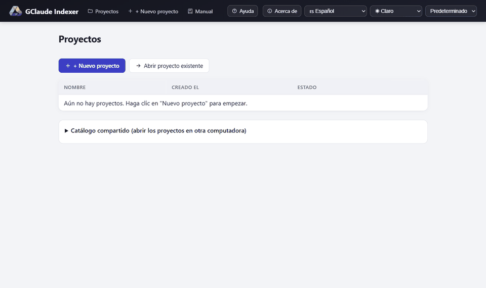
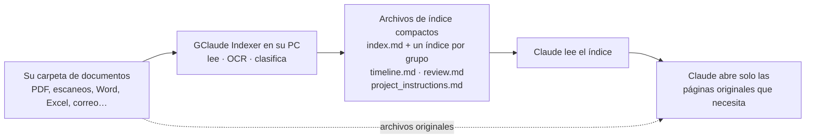
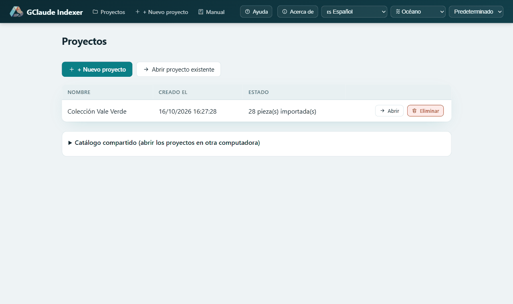
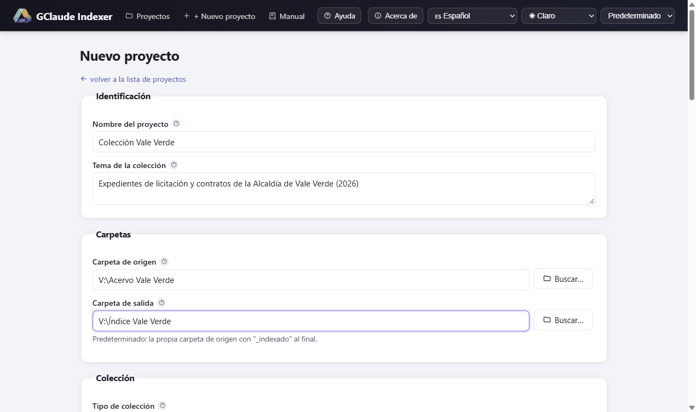
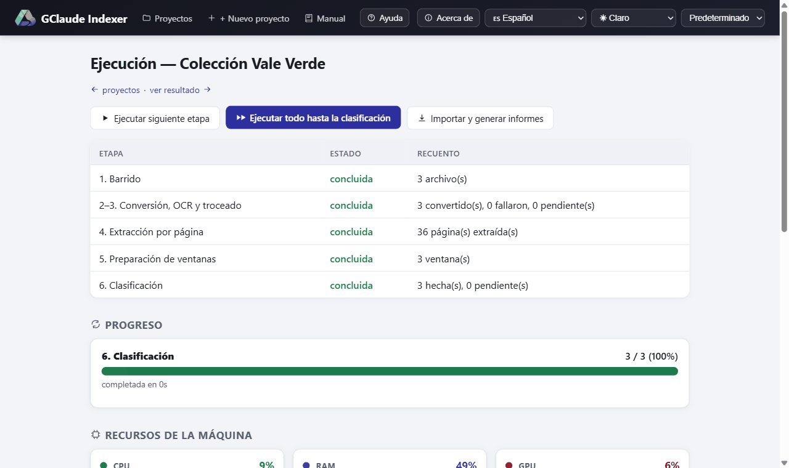
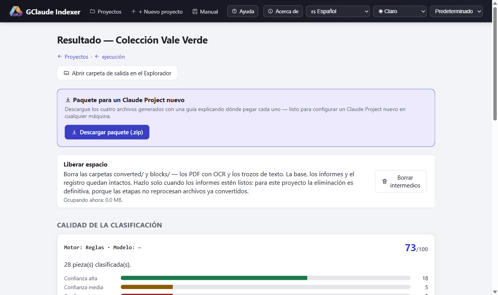
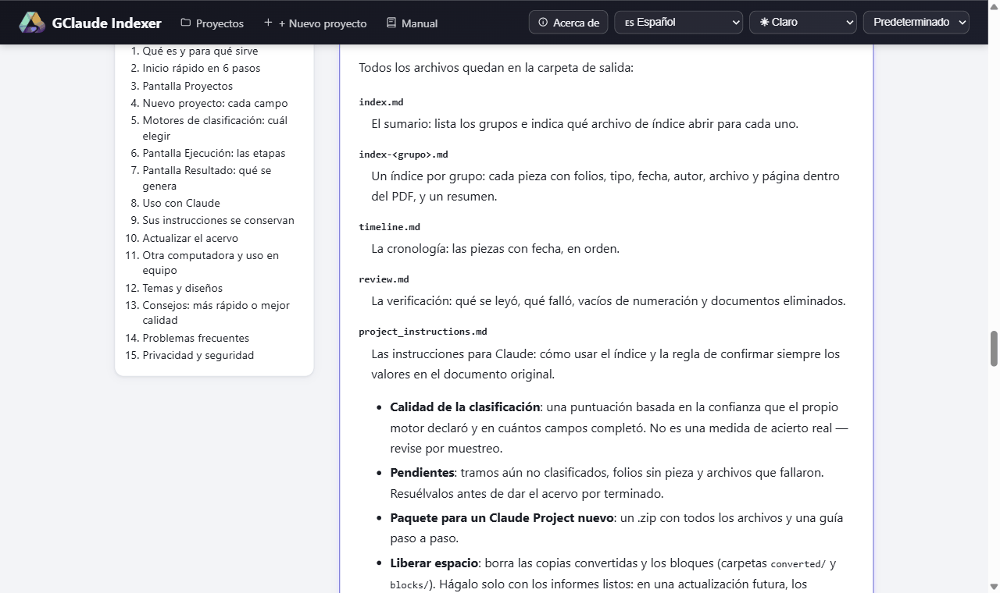

**Léalo en su idioma:** Español — usted está aquí · **[Português (Brasil)](README.pt-BR.md)** · **[English](../README.md)**

# GClaude Indexer

GClaude Indexer lee una carpeta llena de documentos en su propia computadora
con Windows (PDF, escaneos, Word, Excel, correos electrónicos y más) y arma
un índice pequeño y ordenado de todo lo que contiene: qué es cada pieza, de
qué fecha, de quién y en qué página está. Después usted le entrega a Claude
ese índice, y no la pila entera de documentos. Está pensado para quien
trabaja con acervos grandes y usa Claude: abogados, contadores,
investigadores, organismos públicos, pequeñas empresas.



*Un recorrido rápido por el programa.*

## Para qué sirve

**1. Gastar menos de su suscripción paga de Claude.** Claude cuenta cada
página que usted le hace leer. Con GClaude Indexer, Claude lee primero un
índice compacto, descubre qué documento y qué página responden a su
pregunta, y abre solo esos. Ejemplo: una abogada con un expediente de 3.000
páginas pregunta "¿cuándo se presentó el dictamen pericial?". Claude lo
busca en el índice y abre un documento, no las 3.000 páginas.

**2. Trabajar con muchos más documentos de los que Claude soporta a la
vez.** Claude tiene un límite de cuánto texto puede considerar al mismo
tiempo. Un acervo grande no cabe, pero su índice sí: se divide en un
archivo pequeño por grupo, así que incluso miles de páginas se convierten
en algo que Claude puede recorrer. El texto completo queda de su lado,
listo para abrirse página por página.

**3. Sus datos se quedan con usted.** La lectura, el reconocimiento de
texto (OCR) y la clasificación ocurren en su computadora. No se envía nada
a ningún lado mientras se procesa el acervo. El resultado es una base de
datos local y algunos archivos de texto, guardados en una carpeta que usted
elige. Si esa carpeta está en Google Drive, puede abrir el mismo proyecto
desde cualquier computadora conectada a ese Drive.

**4. Mantener el índice al día sin empezar de cero.** Los acervos crecen.
Cuando usted agrega, modifica o elimina documentos, el programa encuentra
lo que cambió y rehace solo esa parte. Le muestra el plan y el costo antes
de tocar nada.

**5. Fácil para una persona o para una oficina entera.** Una persona puede
usarlo en una laptop. Un equipo puede guardar los proyectos en una carpeta
compartida de Drive o en un servidor de archivos. Ejemplo: el equipo de una
oficina comparte una carpeta de Drive con los archivos de los clientes; un
colega actualiza el índice por la mañana y otro abre el mismo proyecto por
la tarde, en otra computadora.

## Cómo funciona en un minuto



1. Usted indica al programa una carpeta de documentos. Nunca modifica esa
   carpeta; solo la lee.
2. En su computadora, convierte cada página en texto (con OCR en los
   escaneos) y descubre dónde empieza y termina cada documento, su tipo,
   fecha, autor y un resumen breve.
3. Escribe unos pocos archivos Markdown pequeños: un sumario (`index.md`),
   un índice por grupo de documentos, una cronología, un informe de
   revisión e instrucciones listas para Claude.
4. Usted le entrega esos archivos a Claude. Cuando necesita detalles, abre
   solo la página original que indica el índice.

Para que se haga una idea del tiempo: un acervo real de unas 2.900 páginas
tardó poco más de 5 horas con el modelo local en una tarjeta gráfica común.
Con el motor de reglas, tarda minutos.

## Pantallas



*Proyectos: todos los acervos que conoce esta computadora, más el catálogo compartido que permite abrir los mismos proyectos en otra computadora.*



*Nuevo proyecto: carpetas, tipos de archivo, idioma del OCR y motor de clasificación en una sola pantalla; en general basta con completar el nombre y la carpeta de origen.*



*Ejecución: los pasos con progreso en vivo, gráficos de CPU/RAM/GPU y un registro escrito en lenguaje sencillo.*



*Resultado: puntuación de calidad, pendientes, vista previa de cada archivo generado y el paquete para Claude.*



*Manual: cada pantalla y cada opción explicadas dentro del programa, en su idioma.*

## Novedades de la versión 1.4

- **Se conservan las instrucciones que ya tiene.** Lo que el programa
  escribe en `project_instructions.md` y `CLAUDE.md` ahora queda entre dos
  marcas (`GCLAUDE-INDEXER:BEGIN` y `GCLAUDE-INDEXER:END`). Solo ese bloque
  se rehace; todo lo demás del archivo es suyo y se queda. La primera vez
  se guarda una copia `.bak` de su archivo original. Un campo nuevo en
  Nuevo proyecto, **Instrucciones que ya usa**, pone sus instrucciones al
  principio del archivo.
- **Eliminación de archivos más segura.** Si un documento eliminado tenía
  una copia idéntica en la carpeta, la copia se indexa en su lugar. Cuando
  sacar un documento del medio de un expediente cambia la numeración de los
  folios de los documentos siguientes, se le avisa en la pantalla de
  confirmación y en el registro. La copia convertida del archivo eliminado
  se borra, y también los índices de los grupos que ya no existen.
- **Manual completo dentro del programa.** El menú **Manual** explica cada
  pantalla y cada opción, en español, portugués e inglés.
- **Registro en vivo en lenguaje sencillo.** Los mensajes dicen qué pasó y
  qué hacer; los detalles técnicos solo aparecen entre paréntesis al final.
- **Cuatro temas nuevos** (Aurora, Toga, Grafito y Océano) y movimiento
  suave entre pantallas, que se desactiva solo cuando Windows pide menos
  movimiento.
- **Seguridad reforzada.** El programa solo acepta solicitudes de sus
  propias pantallas (protección contra CSRF y DNS rebinding), así que un
  sitio web abierto en el navegador no puede darle órdenes. Eliminar un
  proyecto borra solo lo que el programa creó. Las instrucciones del motor
  Claude Code tratan el texto de los documentos como dato no confiable. Las
  llamadas al modelo local nunca pasan por un proxy. Se actualizaron
  FastAPI y Starlette.
- **Pantallas más rápidas.** Consultas de progreso más livianas e índices
  nuevos en la base de datos.

## Instalación

### Qué necesita

- **Windows 10 u 11.** El programa solo funciona en Windows (detalles en
  *Detalles técnicos*, más abajo).
- Algunos gigabytes libres en disco.
- Todo lo demás (Python 3.12, Tesseract, Ghostscript, Ollama y el modelo
  local) se instala por usted.
- Una tarjeta gráfica (GPU) con algunos gigabytes de memoria hace que el
  modelo local sea mucho más rápido, pero no es obligatoria. El modelo
  predeterminado (`qwen3.5:4b`) pesa cerca de 3,2 GB para descargar y cabe
  en una tarjeta de 6 GB tan bien como en una de 8 GB. Si la máquina tiene
  poca memoria, el programa pasa solo al motor `rules` y le explica por
  qué.

### La forma fácil: el instalador de Windows

1. Descargue `GClaude-Indexer-Setup-1.5.6.exe` desde la
   [versión más reciente](https://github.com/alexccastilho/gclaude-indexer/releases/latest).
2. Haga doble clic. Pregunta si la instalación es solo para usted o para
   todos los usuarios de la máquina, muestra la licencia y le permite
   marcar qué dependencias quiere.
3. Descarga e instala todas (Python 3.12, Tesseract con el idioma
   portugués, Ghostscript, Ollama y el modelo de clasificación), con barra
   de progreso y sin abrir ninguna ventana de terminal.

**SmartScreen de Windows le advertirá.** El instalador no está firmado
digitalmente, porque un certificado cuesta dinero que este proyecto no
tiene. Haga clic en "Más información" y luego en "Ejecutar de todos modos".
Es una buena práctica verificar el archivo descargado con el SHA-256
publicado junto a cada versión.

**Sobre Ollama.** Ollama es el programa gratuito que ejecuta el modelo
local en su propia máquina. El instalador instala Ollama y el modelo
predeterminado si usted acepta. Puede omitirlo: el motor `rules` no
necesita nada adicional.

**Desinstalar.** Use Configuración > Aplicaciones, como cualquier programa.
Pregunta, una por una, qué dependencias compartidas deben irse con él.
Nunca borra sus proyectos.

No necesita Git, una cuenta de GitHub ni experiencia en programación. Si no
puede instalar programas en la máquina, vea *Instalación sin el
instalador* en Detalles técnicos.

### Inicio rápido en 6 pasos

1. **Nuevo proyecto.** Haga clic en **+ Nuevo proyecto**, póngale un
   nombre, elija la **Carpeta de origen** (donde están sus documentos) y
   revise la **Carpeta de salida** sugerida. Lo demás puede quedar como
   está. Haga clic en **Crear proyecto**.
2. **Ejecutar todo.** En la pantalla Ejecución, haga clic en **Ejecutar
   todo hasta la clasificación**. Puede dejarlo trabajando y hacer otra
   cosa.
3. **Generar los informes.** Cuando termine la clasificación, haga clic en
   **Importar y generar informes**.
4. **Revisar el resultado.** La pantalla **Resultado** muestra la
   puntuación de calidad, los pendientes y una vista previa de cada
   archivo.
5. **Descargar el paquete.** En **Paquete para un Claude Project nuevo**,
   haga clic en **Descargar paquete (.zip)**.
6. **Usarlo en Claude.** En claude.ai, cree un Project, pegue el contenido
   completo de `project_instructions.md` en sus instrucciones y suba los
   demás archivos como conocimiento del proyecto. Cuando necesite el
   contenido exacto de una pieza, envíe a Claude solo el documento original
   que indica el índice.

En cada pantalla, el botón **Ayuda** muestra un resumen de esa pantalla, y
el **?** junto a cada campo lo explica.

## Uso personal o corporativo

- **Carpeta de salida en Google Drive o en un servidor de archivos.** Cada
  proyecto vive entero en su carpeta de salida. Póngala en Drive o en una
  carpeta de red y cualquier computadora con acceso podrá abrirlo.
- **Catálogo compartido.** En la pantalla Proyectos, indique en **Catálogo
  compartido** una carpeta dentro de su Drive. Todas las computadoras
  conectadas a ese Drive pasan a ver la misma lista de proyectos. Sin él,
  la lista queda en cada máquina, aunque los proyectos se sincronicen.
- **Una computadora a la vez.** Mientras un proyecto está abierto, queda
  bloqueado para esa computadora. A otra computadora se le avisa quién lo
  está usando. El bloqueo vence solo después de un tiempo sin uso.
- **Regla de oro al cambiar de computadora:** cierre el programa en la
  primera, espere a que Google Drive termine de sincronizar y solo entonces
  ábralo en la segunda. El programa avisa de sincronizaciones incompletas,
  pero no reemplaza la espera.

## Privacidad y seguridad

- Los documentos se leen y se clasifican **solo en su computadora**.
  Durante el procesamiento no se envía por la red ningún documento, página
  de texto ni siquiera un nombre de archivo. El motor local se comunica
  únicamente con el Ollama de la misma máquina (`http://127.0.0.1:11434`),
  nunca a través de un proxy.
- El servidor del programa solo escucha en `127.0.0.1` (su propia máquina)
  y nunca es accesible desde la red. Solo acepta solicitudes de sus propias
  pantallas: un sitio web abierto en el navegador no puede darle órdenes.
- La carpeta de origen **nunca se modifica**. Todo lo que produce el
  programa va a la carpeta de salida, separada.
- **La base del proyecto (`project.db`) guarda el texto de las páginas.**
  Si el acervo contiene datos personales protegidos por leyes de
  protección de datos (como la LGPD de Brasil o el RGPD), proteja la
  carpeta de salida como protegería los propios documentos, también en
  Google Drive.
- El contenido llega a Claude **solo cuando usted lo envía**: cuando sube
  los archivos del índice o un documento a un Project de Claude, o cuando
  elige el motor opcional `claude_code`. Entonces ese contenido pasa por su
  cuenta de Claude, según las condiciones de su plan.

## Manual completo

Abra el menú **Manual** en la parte superior de cualquier pantalla del
programa. Cubre cada pantalla y cada opción, qué es más rápido y qué da más
calidad, cómo usar los resultados con Claude, el uso en equipo, los
problemas frecuentes y consejos. Está disponible en español, portugués e
inglés.

## Detalles técnicos

Haga clic en un tema para abrirlo.

<details>
<summary><strong>Requisitos en detalle</strong></summary>

- **Windows 10 u 11, obligatorio.** El programa habla directamente con
  interfaces específicas de Windows: PowerShell, WMI (detección de hardware
  y monitoreo de recursos), el registro de Windows (ubicación de los datos
  de Tesseract y detección de idioma) y Performance Counters (gráficos en
  vivo de CPU/GPU). No funciona en Linux ni en macOS.
- **Python 3.12**, instalado por usted si falta. Este proyecto fija
  versiones de dependencias que los Python más nuevos (3.13, 3.14) rompen,
  así que el instalador busca la 3.12 y, si la máquina no la tiene,
  descarga e instala la 3.12.10 oficial para el usuario actual: sin
  administrador, sin paso manual, y cualquier otro Python ya instalado se
  queda exactamente donde está.
- **OCR** (documentos escaneados sin capa de texto) necesita Tesseract y
  Ghostscript. El instalador instala ambos cuando es posible.
- **El motor `local`** (el predeterminado recomendado) necesita
  [Ollama](https://ollama.com), que el instalador instala si usted acepta.
  Una GPU con algunos gigabytes de VRAM libre lo acelera mucho, pero no es
  obligatoria: Ollama usa toda la memoria de GPU que quepa y desborda el
  resto a la RAM del sistema. El modelo predeterminado (`qwen3.5:4b`) pesa
  cerca de 3,2 GB para descargar y necesita algo más que eso, sumando VRAM
  y RAM, para ejecutarse. Una máquina con poco de ambas cosas pasa
  automáticamente al motor `rules`, con una explicación en pantalla.
- **El motor `rules`** no necesita nada de eso: funciona en cualquier
  máquina Windows capaz de ejecutar Python, sin GPU, sin descargas y sin
  software adicional.
- Algunos gigabytes libres en disco para el entorno de Python y, si lo usa,
  el modelo de Ollama.
- La interfaz está en español, inglés y portugués de Brasil, a elegir en un
  menú del encabezado de la página. El idioma predeterminado sigue el
  idioma de visualización de su Windows.
- El instalador es una comodidad para la primera configuración. El
  programa en sí no se compila en un único `.exe`: sigue siendo scripts de
  Python y PowerShell simples y legibles, y un acceso directo en el
  escritorio lo abre con un doble clic.

</details>

<details>
<summary><strong>Instalación sin el instalador</strong></summary>

Este camino funciona también en una máquina donde no puede instalar
programas. En resumen: ejecute `Indexer.bat` y siga las instrucciones. Paso
a paso:

**1. Ponga el código fuente en su máquina.** Si descargó el proyecto como
`.zip`, haga clic derecho, elija "Extraer todo…" y elija una carpeta común
(por ejemplo, en Documentos, o una carpeta de Google Drive montado con
letra de unidad). Si lo clonó con Git, ya tiene una carpeta. De cualquier
forma, recuerde dónde está; abajo se la llama "la carpeta del proyecto".

**2. Abra PowerShell en la carpeta del proyecto.** En el Explorador de
archivos, abra la carpeta del proyecto y luego mantenga **Shift**, haga
clic derecho en un espacio vacío y elija "Abrir ventana de PowerShell aquí"
(o "Abrir en Terminal"), o haga clic en la barra de direcciones, escriba
`powershell` y pulse Enter. Se abre una ventana azul u oscura, ya "dentro"
de la carpeta del proyecto.

**3. No necesita instalar Python usted mismo.** El instalador del paso 4
lo hace: necesita Python 3.12 en concreto y, si su máquina no lo tiene,
descarga el 3.12 oficial de python.org (versión exacta, checksum
verificado) dentro de su propia carpeta de usuario. Ese paso no pide
administrador. Se instala *al lado* de cualquier otro Python que tenga: si
hoy `python --version` muestra 3.13 o 3.14, lo seguirá mostrando, y las
asociaciones de archivos y el menú Inicio quedan como están. Si prefiere
instalarlo usted antes, es lo mismo que hace el instalador:

```powershell
winget install --id Python.Python.3.12 -e --scope user --silent --accept-package-agreements --accept-source-agreements
```

**4. Ejecute el instalador una vez.** Instala Python 3.12 si falta, crea un
entorno de Python privado para este programa (fuera de la carpeta del
proyecto, para sobrevivir a un cambio de carpeta o a una nueva
sincronización de Google Drive/OneDrive), instala los paquetes de Python,
comprueba Tesseract y Ghostscript (instalándolos si faltan y usted está de
acuerdo) y ofrece un acceso directo en el escritorio.

```powershell
powershell -ExecutionPolicy Bypass -File install.ps1
```

Windows puede mostrar "Windows protegió su PC" la primera vez que ejecuta
un script de PowerShell descargado de internet. Es normal: la opción
`-ExecutionPolicy Bypass` ejecuta solo este script, sin cambiar ninguna
configuración permanente. El instalador muestra su progreso y pregunta
antes de instalar cualquier cosa (Tesseract, Ghostscript y, opcionalmente,
Ollama y su modelo predeterminado, que es una descarga grande). Si algún
paso falla, muestra el comando manual para ejecutar en su lugar. La
primera ejecución puede tardar varios minutos, la mayor parte descargando
paquetes.

**5. Acepte el acceso directo en el escritorio** al final, si lo quiere; es
la forma más fácil de abrir el programa. También se ofrece un *segundo*
acceso directo, opcional, "GClaude Indexer (CPU sensor)": acéptelo solo si
quiere ver la temperatura y el consumo de la CPU en la pantalla Ejecución
(vea *El sensor de CPU, opcional*). Puede cambiar de opinión después con
`install.ps1 -CpuSensorShortcut`.

</details>

<details>
<summary><strong>Uso diario</strong></summary>

Haga doble clic en el acceso directo del escritorio. Aparece una ventana de
consola solo la primera vez, si el instalador todavía necesita ejecutarse;
después el programa arranca sin ninguna ventana visible y abre el
navegador en:

```
http://127.0.0.1:8000
```

El servidor solo escucha en `127.0.0.1`, su propia máquina, y nunca es
accesible desde la red ni desde otra computadora.

Sin el acceso directo, desde la carpeta del proyecto:

```powershell
python launcher.py
```

Esto comprueba el entorno e instala lo que falte antes de iniciar el
servidor, así que también sirve como un comando "que simplemente funcione"
en una máquina donde todavía no ejecutó el instalador.

Para cerrar el programa, cierre la ventana de terminal que abrió (o, si se
ejecuta oculto mediante el acceso directo, finalice `pythonw.exe` en el
Administrador de tareas).

</details>

<details>
<summary><strong>El sensor de CPU, opcional</strong></summary>

El acceso directo "GClaude Indexer (CPU sensor)" hace que Windows pida
administrador cada vez que abre el programa, porque la temperatura y el
consumo de la CPU solo se pueden leer con ese privilegio. Lo que se eleva
**no** es el programa: es un pequeño proceso auxiliar cuya única función
es leer los sensores y devolver los números. El servidor, la indexación y
sus documentos se ejecutan sin ningún privilegio, y el auxiliar se cierra
junto con el programa.

Responder **No** es seguro y no cuesta nada más: el programa se abre
exactamente igual que con el acceso directo común, mostrando temperatura,
consumo y frecuencia de la GPU, y "no medido" en los dos sensores de la
CPU. Nada falla y no aparece ningún error. Todo lo demás, incluidas las
lecturas de la GPU, funciona sin ese acceso directo.

</details>

<details>
<summary><strong>Desinstalación en detalle</strong></summary>

Si instaló con el instalador de Windows, use Configuración > Aplicaciones.

Si no, haga doble clic en `Desinstalar.bat`, en la carpeta del proyecto (la
misma de `Indexer.bat`), o desde una consola:

```powershell
.\Desinstalar.bat
powershell -ExecutionPolicy Bypass -File uninstall.ps1
```

**¿Por qué no simplemente `.\uninstall.ps1`?** Google Drive marca cada
archivo que sincroniza como venido de internet, y la directiva de ejecución
predeterminada de Windows (RemoteSigned) se niega a ejecutar un `.ps1` así
sin firma digital ("el archivo no está firmado digitalmente"). No hay nada
malo en el script: `Desinstalar.bat` pasa `-ExecutionPolicy Bypass` en esa
ejecución, como todos los demás lanzadores de este proyecto. Ejecutar
`install.ps1` también limpia esa marca de los scripts de la carpeta, y
entonces el comando directo funciona.

Pregunta por cada elemento por separado, y la respuesta predeterminada es
siempre **no**. Separa lo que es propio de esta instalación (el entorno
virtual, los accesos directos, las bibliotecas de sensores, la
configuración local, las entradas de PATH y las variables de entorno que
creó) de los programas comunes que solo instaló por usted: Tesseract,
Ghostscript, Ollama, Python y los modelos descargados de Ollama. Otros
programas pueden estar usándolos, así que cada uno se ofrece por separado,
y lo dice claramente.

**Nunca borra sus proyectos.** Las carpetas de salida, sus bases de datos,
los PDF con OCR y los informes generados son sus documentos, no restos de
la instalación. El script indica dónde están, con el tamaño de cada uno, y
deja la decisión en sus manos.

Tres opciones cubren los usos no interactivos:

```powershell
powershell -ExecutionPolicy Bypass -File uninstall.ps1 -WhatIfOnly        # muestra el plan, no elimina nada
powershell -ExecutionPolicy Bypass -File uninstall.ps1 -KeepDependencies  # conserva Tesseract, Ghostscript, Ollama, Python
powershell -ExecutionPolicy Bypass -File uninstall.ps1 -RemoveAll         # dice sí a todo (menos a sus proyectos)
```

La carpeta del propio proyecto, si la sincroniza Google Drive, nunca se
toca: bórrela allí si quiere que desaparezca de todas las computadoras.

</details>

<details>
<summary><strong>Las pantallas del programa</strong></summary>

La interfaz tiene cinco pantallas, más **Manual** y **Acerca de**:

1. **Proyectos**: todos los proyectos que conoce esta computadora, con su
   fecha de creación y su estado. Es donde se abre el programa.
   - **Catálogo compartido**: indique una carpeta dentro de Google Drive y
     todas las computadoras conectadas a ese Drive pasan a ver, abrir,
     editar y eliminar los mismos proyectos. Sin él, la *lista* de
     proyectos queda solo en esta máquina, aunque los proyectos se
     sincronicen; por eso otra computadora mostraría la pantalla vacía. Los
     proyectos guardados en el disco local de otra computadora aparecen
     marcados como fuera de alcance.
   - **Abrir proyecto existente** recibe una carpeta que usted indica y
     reabre el proyecto que contiene: después de reinstalar, en una
     máquina nueva, para una carpeta que movió o que alguien le envió. No se
     recrea nada; la carpeta de salida ya guarda el proyecto entero.
   - **Eliminar** ofrece dos opciones: solo quitar el proyecto de la lista
     (los archivos quedan en el disco) o también borrar los archivos
     generados. En ese caso el programa borra solo lo que él mismo creó
     (base, copias convertidas, informes). Sus propios archivos que estén
     en la carpeta de salida se conservan, y la carpeta solo desaparece si
     queda vacía. En `project_instructions.md` y `CLAUDE.md` se quita solo
     el bloque generado. La carpeta de origen nunca se toca.
2. **Nuevo proyecto**: un formulario para la carpeta de origen (los
   documentos), la carpeta de salida (donde van los resultados), qué tipos
   de archivo incluir, cómo agrupar los documentos y qué motor de
   clasificación usar. Cada campo trae un valor predeterminado razonable y
   una ayuda "?".
3. **Ejecución**: una fila por paso (escaneo, conversión, extracción por
   página, preparación de ventanas, clasificación), cada una con un botón
   para ejecutarlo, una barra de progreso con estimación de tiempo y un
   botón de pausa. Debajo, un registro en vivo en lenguaje sencillo y
   gráficos de CPU/RAM/GPU. Un botón aparte, **Importar y generar
   informes**, convierte los elementos clasificados en los archivos de
   salida cuando termina la clasificación. Si la carpeta de origen cambió
   desde la última ejecución, aparece un aviso arriba poco después de que
   carga la página (no en un proyecto que nunca se ejecutó).
4. **Actualizar acervo**: se llega desde ese aviso. Enumera los documentos
   nuevos, editados y eliminados, nombra los que se reprocesarán e informa
   el costo: cuántos archivos pasan de nuevo por OCR, cuántas ventanas se
   reclasifican, cuántas conservan su clasificación y qué documentos
   tendrán cambiada la numeración de folios. Nada cambia hasta que usted
   confirma. Si la carpeta de origen no se puede leer (un disco
   desconectado, una carpeta movida), lo dice y no ofrece nada, porque una
   carpeta inaccesible nunca debe confundirse con un acervo cuyos
   documentos se borraron todos.
5. **Resultado**: la puntuación de calidad, los pendientes, una vista
   previa de cada archivo generado (solo el comienzo de los muy grandes),
   el paquete para Claude, un botón para abrir la carpeta de salida en el
   Explorador de archivos y **Liberar espacio**, que borra los archivos
   intermedios (las carpetas `converted/` y `blocks/`: PDF con OCR y
   trozos de texto) cuando usted ya esté conforme con el resultado. La
   base, los informes y los registros nunca se tocan con esto.

El encabezado de cada pantalla tiene un selector de idioma, un selector de
tema (Claro, Oscuro, Sepia, Alto contraste, Aurora, Toga, Grafito y
Océano) y un selector de diseño (Predeterminado, Técnico, Editorial y
Compacto). Sus elecciones se recuerdan en su navegador.

</details>

<details>
<summary><strong>Mantener un acervo actualizado</strong></summary>

Un acervo cambia: llegan documentos, un escaneo se reemplaza por uno
mejor, algo se retira. Nada de eso exige indexar todo de nuevo.

Abra el proyecto. Unos segundos después de que aparece la pantalla
Ejecución, si algo cambió en la carpeta de origen, un aviso dice cuánto
("14 nuevos, 3 editados, 1 eliminado"). Sígalo hasta **Actualizar acervo**,
revise el plan y confirme. Después ejecute los pasos como siempre:
encontrarán solo el trabajo que dejó la actualización. Agregar un documento
a un acervo de 500 páginas reclasifica una ventana en vez de treinta y
seis: cerca de un minuto en vez de dieciocho y medio.

**Un paso no forma parte de "Ejecutar todo".** Convertir los elementos
clasificados en los archivos Markdown es un botón propio, **Importar y
generar informes**, en la pantalla Ejecución. Que termine la clasificación
no los escribe. Si omite ese paso, los informes siguen describiendo el
acervo como era antes. El programa se lo recuerda: cuando no queda nada por
procesar, aparece un aviso con el botón, y la pantalla Resultado dice
claramente cuándo los archivos mostrados son anteriores al proyecto y qué
cambió desde entonces. Después de actualizar, vuelva a subir los archivos a
su Project de Claude.

**Por qué no es el acervo entero.** Los documentos se agrupan, y las
páginas de un grupo se leen como una sola secuencia larga, cortada en
ventanas superpuestas; las ventanas son lo que lee el motor de
clasificación. Un cambio invalida el grupo a partir de la primera página
que se desplazó. Todo lo anterior conserva sus páginas y su
clasificación. Un documento agregado al final de un grupo cuesta casi nada;
uno insertado al principio desplaza todas las páginas siguientes y cuesta
más. La pantalla le dice en qué caso está antes de confirmar.

**Documentos eliminados.** Sus páginas y piezas salen del índice, su copia
convertida se borra, y el nombre y el momento de la eliminación quedan
registrados en `review.md`. Si la carpeta tenía una copia idéntica del
documento eliminado, esa copia se indexa en su lugar. Si un grupo
desaparece por completo, se borra su `index-<grupo>.md`.

**Numeración de folios que cambia.** En un acervo de tipo expediente, la
numeración de folios (f. 1, f. 2…) es continua dentro del grupo. Agregar o
quitar un documento en el medio cambia los números de los documentos
siguientes. La pantalla de confirmación los enumera y el registro lo
avisa: las conversaciones antiguas con Claude que citaban esos folios
pueden quedar desactualizadas.

Los documentos que solo necesitan renumeración no pasan de nuevo por OCR:
sus archivos convertidos siguen en disco y simplemente se releen. Solo un
documento cuyo propio contenido cambió paga ese costo.

**Si borró los archivos intermedios** con Liberar espacio, los archivos
convertidos ya no existen, y los documentos que se habrían releído deben
convertirse de nuevo. La actualización lo maneja correctamente; solo tarda
más.

**Si no se puede acceder a la carpeta de origen** (el disco está
desconectado, la carpeta se movió o se renombró), no se ofrece nada y no se
cambia nada.

</details>

<details>
<summary><strong>Lograr una buena clasificación</strong></summary>

Dos cosas deciden más sobre el resultado que cualquier otra.

**Complete Tema de la colección y Tipo de colección en Nuevo proyecto.** El
motor `local` se los muestra al modelo, y son lo que le dice *qué tipo de
documento está leyendo*. Un acervo descrito solo con los valores
predeterminados se clasifica contra ejemplos genéricos, y el modelo
responde correctamente "no sé" para casi todos los tipos. Una frase sobre
el acervo (qué es, de dónde viene, qué documentos tiene) es lo más eficaz
que puede hacer por el resultado. **Rol en las instrucciones** y **Reglas
adicionales** también se transmiten, como contexto.

**Qué modelo usar.** Medido en este proyecto, sobre las mismas ventanas de
un documento de 31 páginas, con todos los modelos ejecutándose por completo
en una tarjeta de 8 GB:

| Modelo | Tamaño | Tipo completado | s/ventana |
|---|---:|---:|---:|
| **`qwen3.5:4b`** (predeterminado) | **3,0 GB** | **100%** | **30,8** |
| `gemma4:e4b` | 3,1 GB | 79,5% | 38,5 |
| `qwen3.5:9b` | 5,3 GB | 79,5% | 86,2 |
| `qwen3:8b` | 5,4 GB | 100% | 108,8 |
| `granite4.2:8b` | 5,7 GB | 100% | 116,9 |

`qwen3.5:4b` alcanza la calidad del mejor de ellos en una cuarta parte del
tiempo y con la mitad de la VRAM, y cabe en una tarjeta de 6 GB tan holgado
como en una de 8 GB: una sola configuración para todas las máquinas. Es el
predeterminado desde la 1.0.1; antes lo era `gemma4:e4b`, que todavía puede
elegir para comparar. El modelo más grande de la misma familia perdió
frente al más pequeño: describir una página es lectura y disciplina de
formato, no razonamiento profundo, así que el tamaño no compra calidad aquí
y cuesta tiempo.

**Elija un modelo que quepa en su tarjeta gráfica.** Lo que no cabe en la
VRAM, Ollama lo ejecuta en la CPU, y la diferencia es grande. En una
tarjeta de 8 GB, un modelo de 9,1 GB se ejecutó con el 17% de sí mismo en
la GPU; uno de 5 GB se ejecutó entero en la GPU. La pantalla Ejecución
muestra la VRAM de su tarjeta, la pantalla Acerca de enumera los modelos
instalados, y el registro avisa cuando el modelo elegido no cabe. Un modelo
que cabe y termina vale más que uno más grande que pasa la ejecución entera
desbordándose.

Si la puntuación de calidad parece baja, abra el registro: informa cómo se
está usando la GPU. En la pantalla Resultado, la puntuación se desglosa en
confianza, campos completados y penalizaciones, para que vea cuál le está
costando. La puntuación se basa en lo que declaró el propio motor; no mide
el acierto real, así que revise algunas piezas por muestreo.

</details>

<details>
<summary><strong>Lo que garantiza el índice</strong></summary>

Dos propiedades se cumplen sin importar qué tan bien haga el modelo su
trabajo, porque el código las impone.

**Cada página llega al índice.** Una página que el modelo nunca mencionó
igual recibe una entrada, con su referencia, su archivo y su propio texto
como resumen, porque el agrupamiento recorre las páginas de la ventana, no
la respuesta del modelo. Una pieza que no pasa la validación se descarta,
pero sus páginas vuelven como entrada de confianza baja en lugar de
desaparecer con ella. Un índice que omite una página en silencio es peor
que ningún índice: lo que falta es invisible.

**Las fechas conservan la precisión que el documento realmente tiene.** Los
documentos fechados por período ("competência 01/2020", "exercício 2019")
se guardan como `2020-01` y `2019`, sin completarlos con un primer día de
mes que la página nunca indicó. La ISO 8601 admite la forma reducida, y
sigue ordenándose correctamente en `timeline.md`. Una fecha cuyo día no
existe (`2021-09-31`) baja al mes; un texto que no es una fecha deja el
campo vacío, y la pieza conserva todo lo demás.

</details>

<details>
<summary><strong>Ventanas, bloques y OCR</strong></summary>

Una **ventana** es una serie de páginas seguidas que el clasificador lee de
una vez para descubrir dónde empieza y termina cada pieza.

**Páginas por ventana** es lo que más afecta la calidad: es cuántas páginas
van en cada solicitud al modelo, que responde con una línea por página. El
valor predeterminado del formulario es 16. Cuando se ajustó el motor
local, 8 dio los mejores resultados: con 16, la respuesta sola pasaba de
3.500 tokens y se truncaba, y con 4 se triplica el número de solicitudes
sin ganancia. Desde la 1.3.2, el motor local nota cuando una respuesta
vuelve incompleta y reintenta con un contexto mayor o dividiendo la
ventana. Si la puntuación es baja con el modelo local, pruebe con 8.
Muchos documentos cortos mezclados funcionan mejor con ventanas más
pequeñas; los documentos largos y estandarizados toleran ventanas más
grandes.

**Páginas por bloque** *no* afecta el índice. Solo corta los PDF muy
grandes en archivos auxiliares dentro de `blocks/`, en la carpeta de
salida, que nada más lee y que Liberar espacio borra. Déjelo en 80; bájelo
solo si un PDF muy grande (más de 500 páginas) hace que la conversión se
quede sin memoria.

**OCR** solo se aplica a las páginas sin capa de texto; el programa revisa
página por página y deja como están las que ya tienen texto. Un PDF con
texto nativo y algunas hojas escaneadas en medio recibe OCR solo en esas
hojas (desde la 1.5.2). Entonces lo que importa es que el **Idioma del
OCR** coincida con sus documentos.

</details>

<details>
<summary><strong>Motores de clasificación</strong></summary>

La clasificación (decidir qué es cada página, quién la escribió y cuándo)
es el único paso en el que usted elige *cómo* se hace el trabajo. Todos los
demás (escaneo, OCR, extracción, generación de informes) son idénticos sea
cual sea el motor elegido, y siempre se ejecutan en local.

| Motor | Costo | ¿Sale de la máquina? | Necesita |
|---|---|---|---|
| `rules` | gratuito | no | nada: funciona en cualquier máquina Windows |
| `local` | gratuito | no | Ollama, instalado automáticamente; más rápido con GPU, funciona sin ella |
| `claude_code` | su suscripción de Claude ya existente | **sí** | Claude Code ya instalado en esta máquina |
| `automatic` | — | — | elige `local` si el hardware lo soporta, si no `rules`; nunca elige `claude_code` por su cuenta |

**`claude_code` es totalmente opcional.** El programa funciona de principio
a fin sin él. Elíjalo solo si ya usa Claude Code y quiere que haga la
clasificación. El programa escribe entonces un `CLAUDE.md` en la carpeta de
salida y le muestra una frase para decirle a Claude Code (`procese las
ventanas`); abra Claude Code en la carpeta de salida, diga la frase y,
cuando termine, haga clic en **Comprobar de nuevo si las ventanas
terminaron**. Ese `CLAUDE.md` le indica a Claude Code que trate el texto
de los documentos como dato no confiable, nunca como instrucciones.

`rules` es determinista: busca marcadores conocidos de tipo de documento,
patrones de fecha y bloques de firma, sin ningún modelo de aprendizaje
automático, así que su resultado es totalmente reproducible y no necesita
instalación. `local` usa un modelo abierto servido por
[Ollama](https://ollama.com) en su propia máquina
(`http://127.0.0.1:11434`, nunca una dirección remota, nunca a través de
un proxy) y en general da mejores resultados que `rules`, a costa del
espacio en disco, la descarga y (opcionalmente) la GPU indicados en
Requisitos.

**Revisar confianza baja**, en Nuevo proyecto, ejecuta `rules` sobre todo y
envía solo las piezas de confianza baja a un segundo motor de su elección:
un punto intermedio entre el costo cero de `rules` y la precisión de un
motor más fuerte en las páginas que lo necesitan. La pantalla Resultado
tiene una tabla para comparar motores y modelos ejecutados sobre el mismo
acervo.

</details>

<details>
<summary><strong>Archivos de salida</strong></summary>

Se escriben en la carpeta de salida que eligió, en el idioma en que esté la
interfaz cuando los genere:

- `index.md`: el sumario. Enumera los grupos y dice qué archivo de índice
  abrir para cada uno.
- `index-<grupo>.md`: un índice por grupo. Cada pieza con sus folios o
  páginas, tipo, fecha, autor, archivo y página dentro del PDF, y un
  resumen.
- `timeline.md`: las piezas fechadas en orden cronológico.
- `review.md`: un informe de revisión: qué se leyó, vacíos, fallos, lo que
  sigue pendiente, y los documentos eliminados de la carpeta de origen,
  con el momento en que salió cada uno. El índice y la cronología
  describen el acervo tal como está hoy; aquí descubre lo que antes había
  en él.
- `project_instructions.md`: instrucciones para un Project de Claude,
  armadas con los campos que completó en Nuevo proyecto, incluidas cómo
  usar el índice y la regla de confirmar siempre los valores en el
  documento original.
- `project.db`: la base del proyecto. Guarda todo, incluido el texto de
  cada página.
- `CLAUDE.md`: solo cuando usa el motor `claude_code`.

**Su propio texto en estos archivos se conserva.** En
`project_instructions.md` y `CLAUDE.md`, el contenido generado queda entre
`<!-- GCLAUDE-INDEXER:BEGIN … -->` y `<!-- GCLAUDE-INDEXER:END -->`. Volver
a generar los archivos rehace solo ese bloque; lo que usted escribió fuera
de él se queda. Si la carpeta de salida ya tenía un `CLAUDE.md` suyo, se
conserva y se le agrega el bloque, y la primera vez se guarda una copia
`.bak` del original. El texto pegado en **Instrucciones que ya usa** va al
principio de `project_instructions.md`.

La pantalla Resultado también ofrece un paquete `.zip` con estos archivos y
una guía breve. La guía indica pegar el `project_instructions.md`
**completo** en las instrucciones del Project y subir `index.md`, los
archivos `index-<grupo>.md`, `timeline.md` y `review.md` como conocimiento
del proyecto.

</details>

<details>
<summary><strong>OCR e idioma de los documentos</strong></summary>

Los proyectos nuevos usan OCR en portugués (`por`) de forma
predeterminada, ya que el proyecto nació para acervos en portugués de
Brasil.

El paquete de Tesseract para Windows trae solo `eng` y `osd`, así que
`install.ps1` descarga los datos del idioma que usa el proyecto (`por`,
por defecto) en la carpeta `tessdata` de Tesseract. Pide permisos de
administrador a Windows solo para esa copia de archivo, y verifica el
SHA-256 antes de instalarlo.

Si su acervo está en otro idioma, cambie el **Idioma del OCR** en Nuevo
proyecto al código correspondiente de Tesseract (por ejemplo `eng` para
inglés, `spa` para español, o `por+eng` para ambos en el mismo acervo) e
instale los datos de ese idioma:

```powershell
powershell -ExecutionPolicy Bypass -File install.ps1 -OcrLanguage spa
```

El instalador solo instala idiomas cuyo SHA-256 tiene fijado: hoy `por`,
`eng`, `spa` y `osd`. Nunca descarga un archivo que no puede verificar;
para cualquier otro idioma, indica dónde conseguir el archivo y dónde
ponerlo, y sigue adelante.

</details>

<details>
<summary><strong>Ejecutar la suite de pruebas</strong></summary>

Si está contribuyendo con cambios, o quiere confirmar que todo funciona
después de instalar, use el Python del entorno que creó el instalador (no
el `python` que encuentre su PATH):

```powershell
& "$env:LOCALAPPDATA\GClaudeIndexer\venv\Scripts\python.exe" -B -m pytest -q
```

Una ejecución correcta termina con una línea como `704 passed, … warnings
in …s` y ningún fallo. El número de pruebas crece con el tiempo; los avisos
vienen de bibliotecas de terceros, no del código de este proyecto, y su
cantidad puede variar según la máquina. Vea
[CONTRIBUTING.es.md](CONTRIBUTING.es.md) (original en inglés:
[CONTRIBUTING.md](../CONTRIBUTING.md)) para la configuración completa de un
entorno de desarrollo.

</details>

<details>
<summary><strong>Solución de problemas</strong></summary>

- **Aparece un aviso de que el sistema se actualizó después de abrir la
  ventana.** El código en disco cambió mientras el servidor se ejecutaba,
  y Python carga los módulos una sola vez, al arrancar. Cierre el programa
  y ábralo de nuevo con el acceso directo; una ejecución iniciada antes
  usaría el código antiguo.
- **El navegador se abre pero la página nunca carga.** Espere unos
  segundos en la primera ejecución. Si sigue sin cargar, compruebe si otro
  programa está usando el puerto 8000.
- **Aparece "Solicitud rechazada".** Algo que no son las pantallas del
  propio programa (en general un sitio web) intentó enviar un comando y
  fue bloqueado. Abra siempre el programa con su acceso directo o en
  `http://127.0.0.1:8000`.
- **"python no se reconoce…" en PowerShell.** Python no está en el PATH.
  Reinstálelo con el comando `winget` de *Instalación sin el instalador*,
  o use la ruta completa al intérprete que aparece en *Ejecutar la suite
  de pruebas*.
- **El OCR falla o no produce texto.** Compruebe que Tesseract y
  Ghostscript estén instalados (`install.ps1` lo verifica) y que el paquete
  de idioma de sus documentos esté instalado (vea *OCR e idioma de los
  documentos*).
- **El motor `local` pasa a `rules`.** O Ollama no se está ejecutando, o la
  suma de su VRAM y la RAM del sistema está por debajo de lo que necesita
  el modelo (vea *Requisitos en detalle*). No es un error: el programa se
  degrada a propósito en lugar de fallar. Abra Ollama y ejecute la
  clasificación de nuevo; la pantalla Acerca de muestra el diagnóstico de
  la instalación.
- **Nada funciona hasta que reinicio después de instalar.** Corregido: el
  instalador anota dónde puso cada programa y `Indexer.bat` recarga el PATH
  desde el registro. En una instalación antigua, ejecute `install.ps1` una
  vez más; ya no hace falta cerrar la sesión.
- **Reinstalé (o formateé) y mis proyectos desaparecieron de la lista.** No
  desaparecieron: los proyectos están en sus carpetas de salida, y solo la
  lista se recreó vacía. Use **Proyectos → Abrir proyecto existente** e
  indique la carpeta de salida de un proyecto; se reabre con su
  configuración y con todo lo ya procesado. Nunca apunte **Nuevo proyecto**
  a una carpeta que ya tiene un proyecto: el programa lo impide, porque la
  intención allí es *abrir*, no crear.
- **Mis proyectos no aparecen en la otra computadora.** Los proyectos se
  sincronizan por Drive, pero la lista es de cada máquina hasta que
  configure un catálogo compartido. Abra **Proyectos → Catálogo
  compartido**, elija una carpeta dentro de su Drive y guarde, en ambas
  computadoras, apuntando a la misma carpeta. Sus proyectos actuales se
  copian allí automáticamente.
- **"Proyecto en uso en otra máquina".** Cierre el programa en la otra
  computadora. Si se colgó o se apagó, espere a que venza el bloqueo o
  elija **Asumir de todos modos**, solo si está seguro de que la otra no lo
  está usando.
- **"Posible sincronización incompleta" al abrir un proyecto en una
  segunda máquina justo después de la primera.** Espere a que Google Drive
  (o lo que sincronice su carpeta de salida) termine antes de abrirlo en
  otro lugar. El programa detecta sincronizaciones incompletas y el
  bloqueo de otra máquina, pero no reemplaza la espera.
- **Archivos con fallo en los pendientes.** En general son archivos
  protegidos con contraseña o dañados. Guarde una copia sin protección en
  la carpeta de origen y actualice el acervo.

</details>

<details>
<summary><strong>Documentación</strong></summary>

- [CONTRIBUTING.es.md](CONTRIBUTING.es.md): configuración del entorno de
  desarrollo, cómo ejecutar una sola prueba y las convenciones del
  proyecto.
- [SPECIFICATION.md](SPECIFICATION.md): la especificación técnica
  completa, en inglés: modelo de datos, cada paso del procesamiento,
  reglas de seguridad y decisiones de diseño.
- [CHANGELOG.es.md](CHANGELOG.es.md): qué cambió, versión por versión. El
  original es el [CHANGELOG.md](../CHANGELOG.md) en inglés (convención del
  formato); si ambos divergen, vale el inglés.
- [SECURITY.md](../SECURITY.md): cómo reportar una vulnerabilidad (en
  inglés).
- [CODE_OF_CONDUCT.md](../CODE_OF_CONDUCT.md): normas de convivencia para
  quienes contribuyen (en inglés).

</details>

## Licencia

GClaude Indexer está licenciado bajo la **GNU General Public License v3.0**
(GPL-3.0); vea [LICENSE](../LICENSE) para el texto completo. En resumen:
usted es libre de usar, estudiar, modificar y redistribuir este software,
incluso comercialmente, pero cualquier versión modificada que distribuya
también debe licenciarse bajo la GPL-3.0, con su código fuente disponible.
No hay garantía de ningún tipo.
