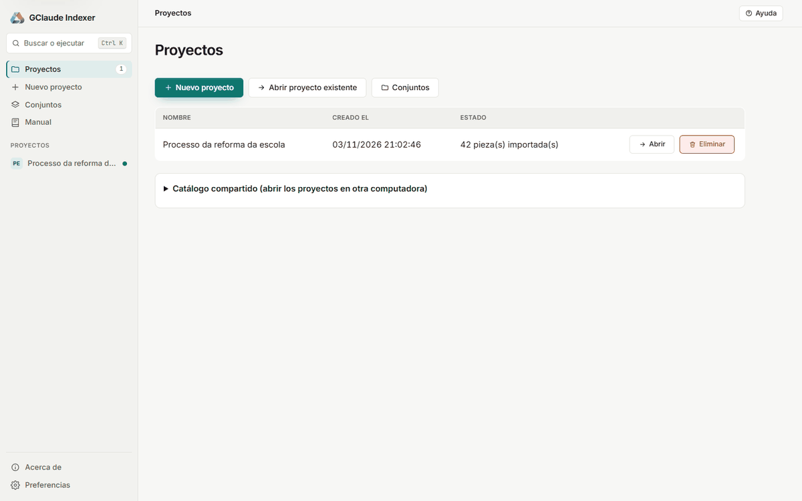
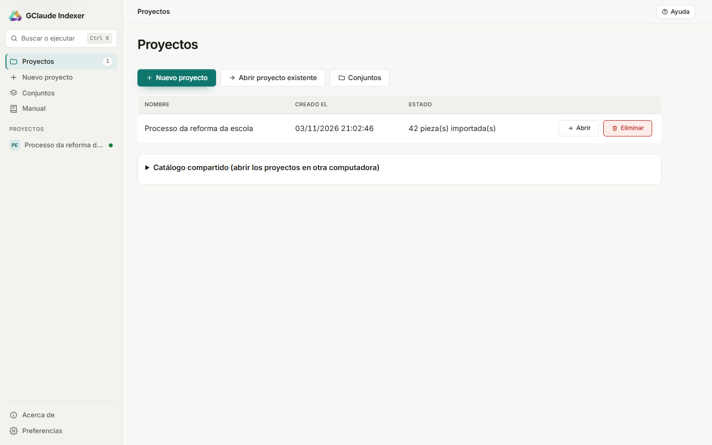
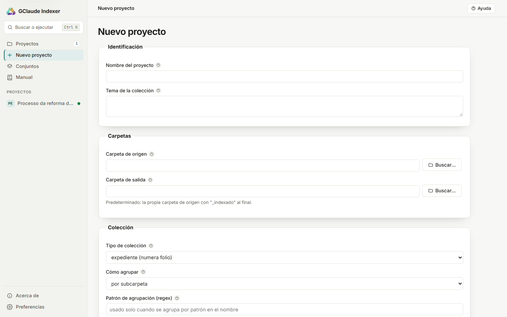
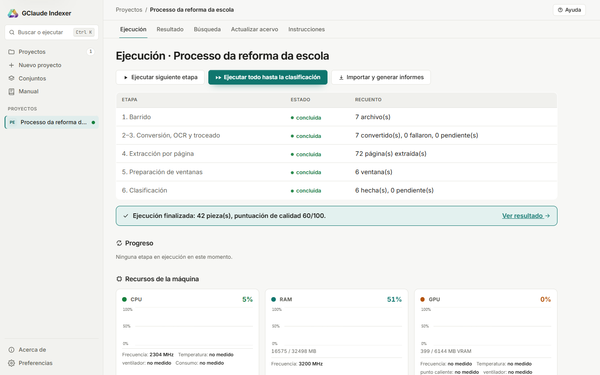
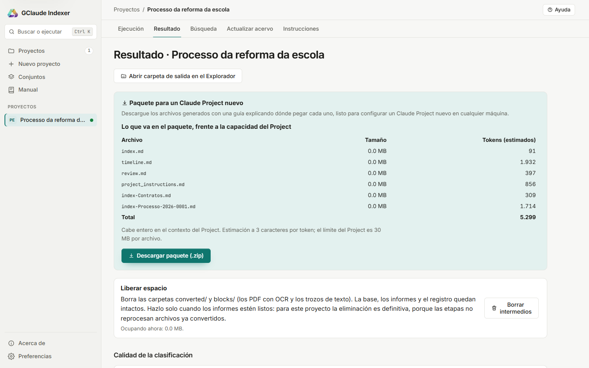
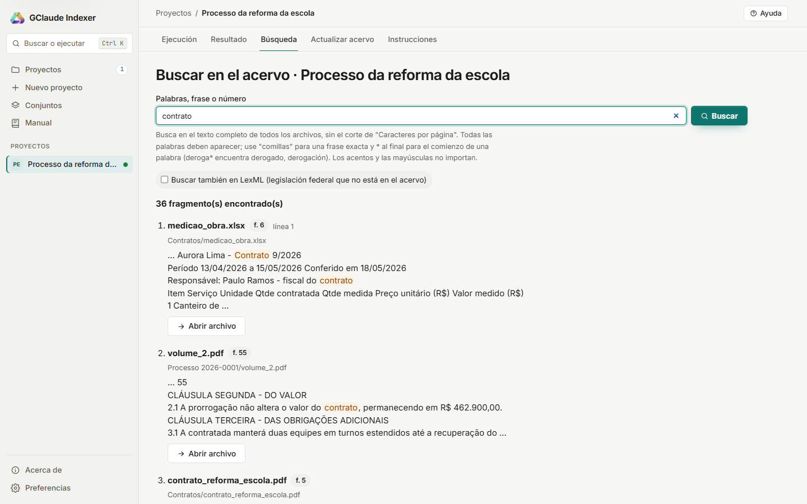
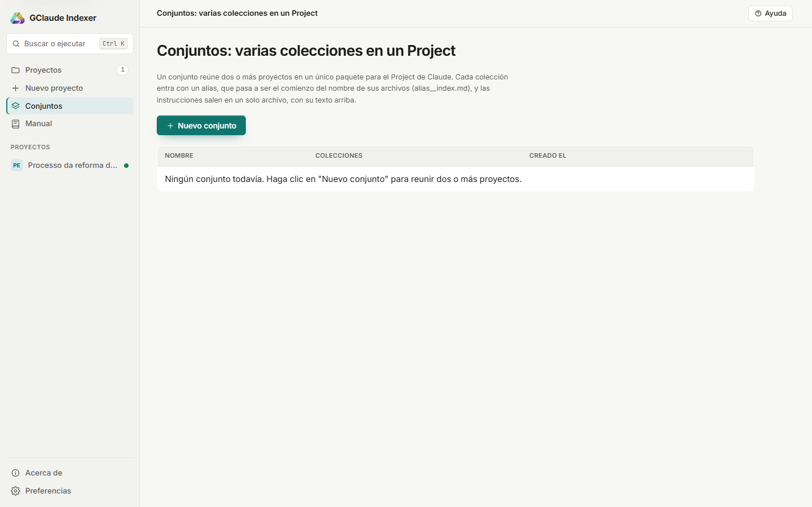
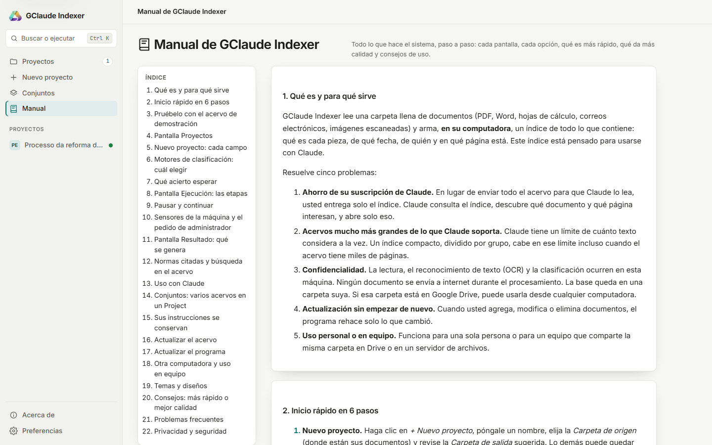

**Léalo en su idioma:** Español, usted está aquí · **[Português (Brasil)](README.pt-BR.md)** · **[English](../README.md)**

# GClaude Indexer

 

GClaude Indexer lee una carpeta llena de documentos en su computadora con Windows (PDF, escaneos, Word, Excel, correos) y arma un índice pequeño de todo lo que hay en ella: qué es cada pieza, de qué fecha, de quién y en qué página está. Usted le entrega a Claude solo ese índice. Nada sale de su computadora mientras se lee el acervo.

*Un recorrido por el diseño Área de trabajo (1.10.0): los proyectos en la barra lateral, las pestañas de un proyecto, la paleta de comandos (Ctrl+K) que lleva a la búsqueda y el tema Estudio oscuro.*

## Tres personas que lo usan

**Una abogada con un expediente de 3.000 páginas.** Le pregunta a Claude "¿cuándo se agregó el dictamen pericial?". Claude busca en el índice, encuentra la pieza, el folio y el archivo, y abre solo ese documento. Sin el índice, ella tendría que mandar las 3.000 páginas, y Claude no acepta tanto de una vez.

**Un funcionario que lleva expedientes administrativos.** La carpeta crece todas las semanas. Abre el programa, ve el aviso "14 nuevos, 3 modificados, 1 eliminado", confirma, y solo esa parte se vuelve a leer. El índice sigue al día y las conversaciones anteriores con Claude siguen valiendo, salvo que un documento haya entrado o salido del medio del expediente y cambiado la numeración de los folios siguientes.

**Un estudio con tres acervos.** Contratos, actas y correspondencia viven en proyectos separados. En la pantalla Conjuntos, los tres se vuelven un solo paquete, y un único Claude Project responde "¿en qué acervo está la adenda de 2019?" y va directo al archivo correcto.

## Lo que usted recibe

Algunos archivos de texto pequeños en la carpeta de salida que eligió:

- `index.md`: el sumario, con un índice por grupo de documentos al lado (`index-<grupo>.md`). Cada pieza con tipo, fecha, autor, archivo y página.
- `timeline.md`: las piezas en orden de fecha.
- `normas-citadas.md`: las leyes y demás actos citados en el acervo, con enlace al texto de cada uno.
- `review.md`: qué se leyó, qué falló y qué se quitó de la carpeta.
- `project_instructions.md`: las instrucciones listas para pegar en el Claude Project, el espacio de claude.ai que guarda instrucciones y archivos para todas las conversaciones sobre un mismo asunto.
- `buscar.bat`: la búsqueda por tema para quien usa Claude Code, la versión de Claude que corre en una ventana de comandos de su computadora y lee los archivos directo del disco.

Y un paquete `.zip` con los archivos del índice, medido antes de descargar: el programa muestra cuántos tokens va a ocupar el paquete en el Project y avisa cuando un archivo quedaría demasiado grande. El token es la medida de texto de Claude: tres o cuatro letras, en promedio.

*Proyectos: todos los acervos que esta computadora conoce.*

*Nuevo proyecto: en general basta el nombre y la carpeta de origen; el resto lo propone el programa a partir de lo que encuentra en la carpeta.*

*Ejecución: las etapas con progreso, el registro en lenguaje simple y los sensores de CPU, memoria y tarjeta de video.*

*Resultado: nota de calidad, pendientes, vista previa de cada archivo y el paquete para Claude con el presupuesto de tokens.*

*Buscar en el acervo: el término, el archivo, la página y el fragmento; la consulta a LexML es opcional.*

*Conjuntos: varios acervos en un único Claude Project.*

*Manual: cada pantalla y cada opción explicadas dentro del programa.*

## Lo que necesita tener

- Windows 10 u 11.
- Algunos gigabytes libres en disco.
- No hace falta instalar nada antes. El instalador trae Python, el OCR (Tesseract y Ghostscript, que leen páginas escaneadas), Ollama, que es el programa que ejecuta el modelo local, y el propio modelo; lo que es opcional, lo muestra en una lista antes de descargar. Internet solo se usa en ese momento.
- Una tarjeta de video con 6 GB o más hace al modelo local bastante más rápido. Sin tarjeta, corre despacio en la memoria común, y el motor de reglas hace el trabajo en segundos.

El programa clasifica las piezas de dos maneras. El motor de reglas reconoce cada pieza por patrones del texto, como los títulos de las piezas, y termina en segundos. El modelo local es un programa de inteligencia artificial que lee cada fragmento, acierta más la fecha y el autor, y tarda más. La opción predeterminada, Automático, usa el modelo local cuando la computadora lo aguanta y las reglas cuando no.

Para instalar, descargue `GClaude-Indexer-Setup-1.10.2.exe` en la [versión más reciente](https://github.com/alexccastilho/gclaude-indexer/releases/latest) y haga doble clic. Windows va a mostrar un aviso de SmartScreen, porque el instalador no tiene firma digital paga: haga clic en "Más información" y después en "Ejecutar de todas formas". En la pantalla Dependencias, el instalador lista lo que va a descargar e instalar junto; deje todo marcado. El elemento más grande es el modelo local, de unos 3 GB, que se descarga una sola vez. El elemento del lector de temperatura de la CPU pide permiso de administrador de Windows; puede aceptar. Al terminar, el programa abre una página en su navegador, en la dirección `http://127.0.0.1:8000`, y el acceso directo del escritorio hace lo mismo las próximas veces. Para actualizar, instale la versión nueva encima; sus proyectos quedan donde están. Para desinstalar, use Configuración > Aplicaciones: pregunta qué quitar y nunca borra sus proyectos.

Quien no puede instalar programas en la máquina, o quiere correrlo desde el código, tiene el camino completo en [docs/TECHNICAL.es.md](TECHNICAL.es.md).

## Diez minutos para probarlo

No necesita un acervo propio. La carpeta `demo/acervo` del repositorio es un acervo pequeño y enteramente inventado: 72 páginas y 41 piezas, con dos tomos de un expediente en PDF, un contrato, un memorando en Word, una planilla, un oficio escaneado y un correo. El archivo `demo/gabarito.csv` dice qué es cada página. El instalador no trae esa carpeta: en la página del proyecto en GitHub, haga clic en el botón verde **Code**, después en **Download ZIP**, y descomprima el archivo en una carpeta suya.

1. Abra el programa y haga clic en **Nuevo proyecto**. Póngale un nombre y apunte la carpeta de origen a `demo/acervo`. En **Extensiones incluidas**, marque PDF, Word, Excel, imágenes y correo. Haga clic en **Crear proyecto**.
2. En la pantalla Ejecución, haga clic en **Ejecutar todo hasta la clasificación**. Con el motor de reglas tarda segundos; con el modelo local, algunos minutos.
3. Cuando termine, haga clic en **Importar y generar informes** y abra la pantalla **Resultado**.
4. Haga clic en **Descargar paquete (.zip)**. En claude.ai, cree un Project, pegue el contenido entero de `project_instructions.md` en el campo de instrucciones y suba los otros archivos como conocimiento del proyecto. El `.zip` trae una guía paso a paso con esas etapas.
5. Pregúntele a Claude: "¿cuál es el valor del contrato y quién lo firmó?". Encuentra la pieza en el índice y pide el archivo original solo si necesita el texto exacto.

En toda pantalla, el botón **Ayuda** resume la pantalla y el **?** al lado de cada campo explica el campo.

## Cuánto acierta

El índice se mide contra la clave de respuestas del acervo de demostración en cada versión que toque el clasificador, y una prueba automática en GitHub repite la medición con cada cambio en el código. En la última medición (02/11/2026), ninguna página se perdió con ninguno de los dos motores. El motor de reglas encontró 36 de las 41 piezas en 4 segundos y acertó el tipo del 94% de ellas, pero la fecha de solo la mitad de ellas y el autor de solo una de cada cinco. El modelo local (`qwen3.5:9b`) tardó 4 minutos, acertó la fecha del 89% y el autor del 84% de las piezas encontradas, y cortó más piezas de las que debía.

Lo que eso quiere decir en la práctica: toda página del acervo está en el índice, aunque el tipo o la fecha salgan mal, y Claude verifica el texto en el documento original antes de responder; así lo ordenan las instrucciones. Los números completos, lo que significa cada uno y lo que no dicen están en [docs/QUALITY.es.md](QUALITY.es.md).

## Privacidad

- Los documentos se leen, pasan por el OCR y se clasifican solo en su computadora. Durante el procesamiento, ningún documento, página ni nombre de archivo se envía por la red. El modelo local habla únicamente con el Ollama de la misma máquina.
- El programa solo escucha en su propia máquina (`127.0.0.1`) y solo acepta pedidos de sus propias pantallas: un sitio abierto en el navegador no puede darle órdenes.
- La carpeta de origen nunca se modifica. Todo lo que el programa produce va a la carpeta de salida.
- La base del proyecto (`project.db`) guarda el texto de las páginas. Si el acervo tiene datos personales, proteja la carpeta de salida como protegería los documentos, también en Google Drive.
- El contenido llega a Claude solo cuando usted lo envía: al subir los archivos del índice a un Project, al mandar un documento, o al elegir el motor opcional `claude_code`. La única consulta externa es la búsqueda en LexML, que envía solo el término que usted escribió: en la pantalla, solo con la casilla marcada; en `buscar.bat`, también cuando ninguna norma del acervo cita el término.

## Varios acervos en un Project

Cada proyecto es un acervo. Cuando la pregunta atraviesa varios ("¿qué tenemos sobre el proveedor X en contratos y en actas?"), la pantalla **Conjuntos** junta dos o más proyectos en un solo paquete. Cada acervo recibe un alias corto, cada archivo lleva el alias en el nombre, y un único `project_instructions.md` le dice a Claude en qué acervo buscar cada cosa. El botón **Grabar en la carpeta** hace lo mismo para Claude Code, con un `CLAUDE.md` que apunta a cada acervo. Un acervo cuya carpeta no está accesible en esta computadora queda fuera, con el motivo en pantalla, y vuelve solo cuando la carpeta vuelva.

## Legislación y búsqueda

Las páginas de leyes, decretos y portarias guardadas del sitio del Planalto (la Presidencia de Brasil) se reconocen por la propia estructura de la página, sin modelo. Cada norma citada en el acervo se vuelve una línea de `normas-citadas.md`, con el número, la fecha, el resumen, dónde aparece y un enlace al texto en LexML, el portal de legislación del Senado brasileño. Claude no necesita el texto de la ley dentro del Project: abre el enlace cuando lo necesita.

La pantalla **Buscar en el acervo** busca una palabra o expresión en el texto de todas las páginas y muestra el archivo, la página y el fragmento. Una casilla opcional consulta también LexML para listar las normas que tratan el tema. Quien usa Claude Code tiene la misma búsqueda en la línea de comandos, con el `buscar.bat` que queda en la carpeta de salida.

## En equipo

Ponga la carpeta de salida en Google Drive o en una carpeta de red, y cualquier computadora con acceso abre el mismo proyecto. En la pantalla Proyectos, apunte el **Catálogo compartido** a una carpeta del Drive y todas las computadoras pasan a ver la misma lista. Un proyecto abierto queda bloqueado para esa computadora; la otra recibe el aviso. Al cambiar de computadora, cierre el programa en la primera y espere a que el Drive termine de sincronizar antes de abrir en la segunda.

## Manual y ayuda

El menú **Manual**, arriba de cualquier pantalla, cubre cada pantalla y cada opción, qué es más rápido y qué da más calidad, cómo usar los resultados con Claude y con Claude Code, el uso en equipo y los problemas comunes. Está en portugués, inglés y español.

Para quien instala y mantiene: [docs/TECHNICAL.es.md](TECHNICAL.es.md) tiene los requisitos en detalle, la instalación sin el instalador, qué contiene cada archivo de salida, las variables que el instalador graba para Ollama y la solución de problemas. Lo que cambió en cada versión está en [docs/CHANGELOG.es.md](CHANGELOG.es.md). Para contribuir, lea [docs/CONTRIBUTING.es.md](CONTRIBUTING.es.md); para reportar una falla de seguridad, [SECURITY.md](../SECURITY.md).

## Licencia

GClaude Indexer se distribuye bajo la **GNU General Public License v3.0** (GPL-3.0); vea [LICENSE](../LICENSE). Usted es libre de usar, estudiar, modificar y redistribuir este software, también comercialmente, siempre que cualquier versión modificada que distribuya también se licencie bajo la GPL-3.0, con el código fuente disponible. No hay garantía de ningún tipo.
