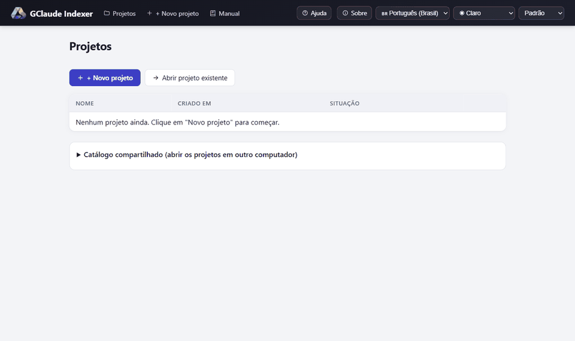
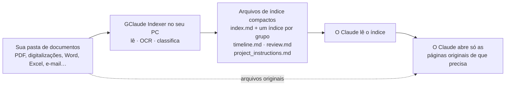
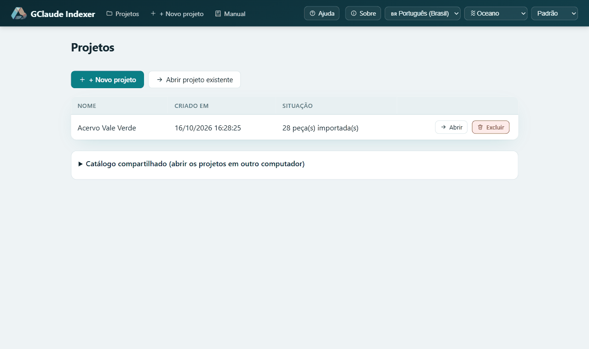
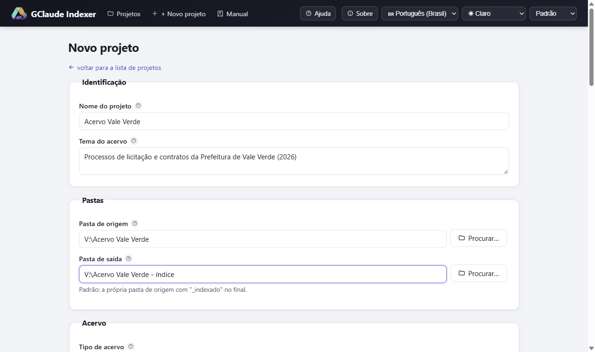
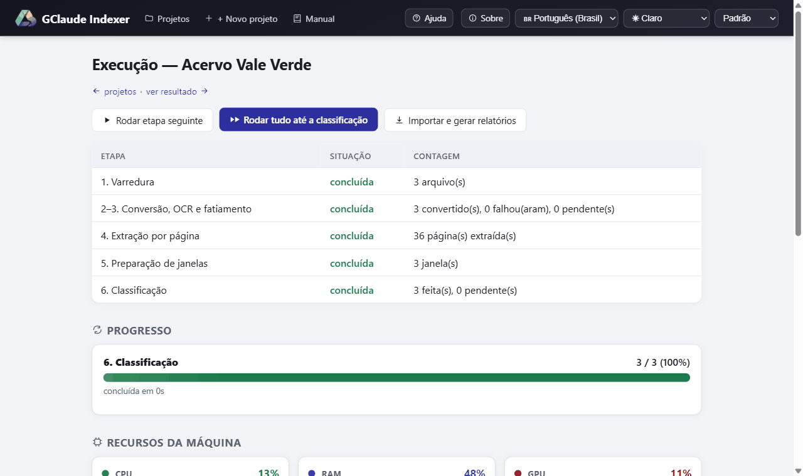
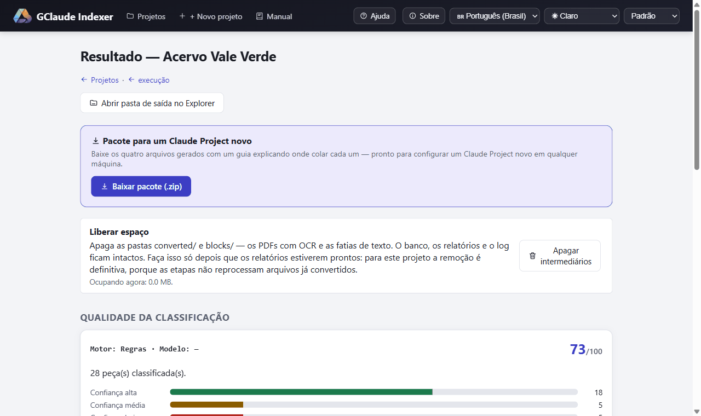
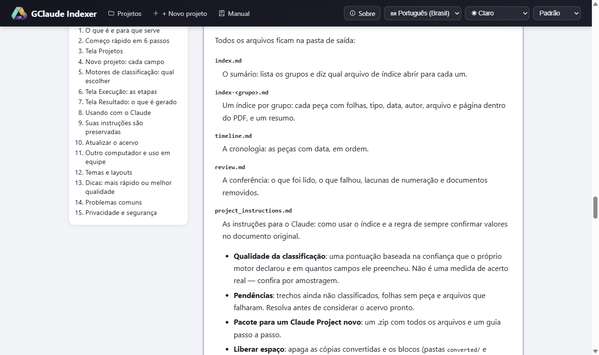

**Leia no seu idioma:** Português (Brasil) — você está aqui · **[English](../README.md)** · **[Español](README.es.md)**

# GClaude Indexer

O GClaude Indexer lê uma pasta cheia de documentos no seu próprio
computador com Windows (PDFs, digitalizações, Word, Excel, e-mails e mais) e
monta um índice pequeno e organizado de tudo o que há nela: o que é cada
peça, de que data, de quem e em que página está. Depois você entrega ao
Claude esse índice, e não a pilha inteira de documentos. Foi feito para
quem trabalha com acervos grandes e usa o Claude: advogados, contadores,
pesquisadores, órgãos públicos, pequenas empresas.



*Um passeio rápido pelo programa.*

## Para que serve

**1. Gastar menos da sua assinatura paga do Claude.** O Claude conta cada
página que você manda ele ler. Com o GClaude Indexer, o Claude lê primeiro
um índice compacto, descobre qual documento e qual página respondem à sua
pergunta, e abre só esses. Exemplo: uma advogada com um processo de 3.000
páginas pergunta "quando o laudo pericial foi juntado?". O Claude procura
no índice e abre um documento, não as 3.000 páginas.

**2. Trabalhar com muito mais documentos do que o Claude aguenta de uma
vez.** O Claude tem um limite de quanto texto consegue considerar ao mesmo
tempo. Um acervo grande não cabe, mas o índice dele cabe: ele é dividido em
um arquivo pequeno por grupo, então até milhares de páginas viram algo que
o Claude consegue percorrer. O texto completo fica do seu lado, pronto
para ser aberto página por página.

**3. Seus dados ficam com você.** Leitura, reconhecimento de texto (OCR) e
classificação acontecem no seu computador. Nada é enviado para lugar
nenhum enquanto o acervo é processado. O resultado é uma base de dados
local e alguns arquivos de texto, guardados numa pasta que você escolhe. Se
essa pasta estiver no Google Drive, você abre o mesmo projeto de qualquer
computador conectado a esse Drive.

**4. Manter o índice em dia sem começar do zero.** Acervos crescem. Quando
você acrescenta, altera ou remove documentos, o programa encontra o que
mudou e refaz só essa parte. Ele mostra o plano e o custo antes de mexer em
qualquer coisa.

**5. Fácil para uma pessoa ou para um escritório inteiro.** Uma pessoa pode
usar num notebook. Uma equipe pode guardar os projetos numa pasta
compartilhada do Drive ou num servidor de arquivos. Exemplo: a equipe de
um escritório divide uma pasta do Drive com os arquivos dos clientes; um
colega atualiza o índice de manhã, outro abre o mesmo projeto à tarde, em
outro computador.

## Como funciona em um minuto



1. Você aponta o programa para uma pasta de documentos. Ele nunca altera
   essa pasta; só lê.
2. No seu computador, ele transforma cada página em texto (com OCR nas
   digitalizações) e descobre onde cada documento começa e termina, o tipo,
   a data, o autor e um resumo curto.
3. Ele grava alguns arquivos Markdown pequenos: um sumário (`index.md`), um
   índice por grupo de documentos, uma cronologia, um relatório de
   conferência e instruções prontas para o Claude.
4. Você entrega esses arquivos ao Claude. Quando ele precisa de detalhes,
   abre só a página original que o índice aponta.

Para ter uma ideia de tempo: um acervo real de cerca de 2.900 páginas levou
pouco mais de 5 horas com o modelo local numa placa de vídeo comum. Com o
motor de regras, leva minutos.

## Telas



*Projetos: todos os acervos que este computador conhece, mais o catálogo compartilhado que permite abrir os mesmos projetos em outro computador.*



*Novo projeto: pastas, tipos de arquivo, idioma do OCR e motor de classificação numa tela só; em geral basta preencher o nome e a pasta de origem.*



*Execução: as etapas com progresso ao vivo, gráficos de CPU/RAM/GPU e um log escrito em linguagem simples.*



*Resultado: nota de qualidade, pendências, prévia de cada arquivo gerado e o pacote para o Claude.*



*Manual: cada tela e cada opção explicadas dentro do programa, no seu idioma.*

## Novidades da versão 1.4

- **As instruções que você já tem são preservadas.** O que o programa
  escreve em `project_instructions.md` e `CLAUDE.md` agora fica entre duas
  marcas (`GCLAUDE-INDEXER:BEGIN` e `GCLAUDE-INDEXER:END`). Só esse bloco é
  refeito; todo o resto do arquivo é seu e continua lá. Na primeira vez,
  uma cópia `.bak` do seu arquivo original é guardada. Um campo novo no
  Novo projeto, **Instruções que você já usa**, coloca as suas instruções
  no topo do arquivo.
- **Remoção de arquivos mais segura.** Se um documento removido tinha uma
  cópia idêntica na pasta, a cópia passa a ser indexada no lugar dele.
  Quando tirar um documento do meio de um processo muda a numeração das
  folhas dos documentos seguintes, você é avisado na tela de confirmação e
  no log. A cópia convertida do arquivo removido é apagada, e os índices de
  grupos que deixaram de existir também.
- **Manual completo dentro do programa.** O menu **Manual** explica cada
  tela e cada opção, em português, inglês e espanhol.
- **Log ao vivo em linguagem simples.** As mensagens dizem o que aconteceu
  e o que fazer; os detalhes técnicos só aparecem entre parênteses no fim.
- **Quatro temas novos** (Aurora, Toga, Grafite e Oceano) e movimento suave
  entre as telas, desligado automaticamente quando o Windows pede menos
  movimento.
- **Segurança reforçada.** O programa só aceita pedidos das próprias telas
  (proteção contra CSRF e DNS rebinding), então um site aberto no navegador
  não consegue dar ordens a ele. Excluir um projeto apaga só o que o
  programa criou. As instruções do motor Claude Code tratam o texto dos
  documentos como dado não confiável. As chamadas ao modelo local nunca
  passam por proxy. FastAPI e Starlette foram atualizados.
- **Telas mais rápidas.** Consultas de progresso mais leves e índices novos
  no banco de dados.

## Instalação

### Do que você precisa

- **Windows 10 ou 11.** O programa só roda no Windows (detalhes em
  *Detalhes técnicos*, abaixo).
- Alguns gigabytes livres em disco.
- Todo o resto (Python 3.12, Tesseract, Ghostscript, Ollama e o modelo
  local) é instalado para você.
- Uma placa de vídeo (GPU) com alguns gigabytes de memória deixa o modelo
  local bem mais rápido, mas não é obrigatória. O modelo padrão
  (`qwen3.5:4b`) tem cerca de 3,2 GB para baixar e cabe numa placa de 6 GB
  tão bem quanto numa de 8 GB. Se a máquina tiver memória de menos, o
  programa passa sozinho para o motor `rules` e explica o motivo.

### O jeito fácil: o instalador do Windows

1. Baixe o `GClaude-Indexer-Setup-1.5.1.exe` na
   [versão mais recente](https://github.com/alexccastilho/gclaude-indexer/releases/latest).
2. Dê dois cliques. Ele pergunta se a instalação é só para você ou para
   todos os usuários da máquina, mostra a licença e deixa você marcar quais
   dependências quer.
3. Ele baixa e instala todas (Python 3.12, Tesseract com o idioma
   português, Ghostscript, Ollama e o modelo de classificação), com barra
   de progresso e sem abrir nenhuma janela de terminal.

**O SmartScreen do Windows vai avisar.** O instalador não é assinado
digitalmente, porque um certificado custa dinheiro que este projeto não
tem. Clique em "Mais informações" e depois em "Executar assim mesmo". É uma
boa prática conferir o arquivo baixado pelo SHA-256 publicado junto de cada
versão.

**Sobre o Ollama.** O Ollama é o programa gratuito que roda o modelo local
na sua própria máquina. O instalador instala o Ollama e o modelo padrão se
você aceitar. Dá para pular: o motor `rules` não precisa de nada extra.

**Desinstalar.** Use Configurações > Aplicativos, como qualquer programa.
Ele pergunta, uma a uma, quais dependências compartilhadas devem sair
junto. Ele nunca apaga os seus projetos.

Você não precisa de Git, de conta no GitHub nem de experiência com
programação. Se não puder instalar programas na máquina, veja *Instalando
sem o instalador* em Detalhes técnicos.

### Começo rápido em 6 passos

1. **Novo projeto.** Clique em **+ Novo projeto**, dê um nome, escolha a
   **Pasta de origem** (onde estão seus documentos) e confira a **Pasta de
   saída** sugerida. O resto pode ficar como está. Clique em **Criar
   projeto**.
2. **Rodar tudo.** Na tela Execução, clique em **Rodar tudo até a
   classificação**. Pode deixar rodando e fazer outra coisa.
3. **Gerar os relatórios.** Quando a classificação terminar, clique em
   **Importar e gerar relatórios**.
4. **Conferir o resultado.** A tela **Resultado** mostra a nota de
   qualidade, as pendências e uma prévia de cada arquivo.
5. **Baixar o pacote.** Em **Pacote para um Claude Project novo**, clique
   em **Baixar pacote (.zip)**.
6. **Usar no Claude.** Em claude.ai, crie um Project, cole o conteúdo
   inteiro de `project_instructions.md` nas instruções e envie os outros
   arquivos como conhecimento do projeto. Quando precisar do conteúdo exato
   de uma peça, mande ao Claude só o documento original que o índice
   aponta.

Em toda tela, o botão **Ajuda** mostra um resumo daquela tela, e o **?** ao
lado de cada campo explica o campo.

## Uso pessoal ou corporativo

- **Pasta de saída no Google Drive ou num servidor de arquivos.** Cada
  projeto vive inteiro na sua pasta de saída. Coloque-a no Drive ou numa
  pasta de rede e qualquer computador com acesso consegue abri-lo.
- **Catálogo compartilhado.** Na tela Projetos, aponte o **Catálogo
  compartilhado** para uma pasta dentro do seu Drive. Todo computador
  conectado a esse Drive passa a ver a mesma lista de projetos. Sem ele, a
  lista fica em cada máquina, mesmo com os projetos sincronizados.
- **Um computador por vez.** Enquanto um projeto está aberto, ele fica
  travado para aquele computador. Outro computador é avisado de quem está
  usando. A trava expira sozinha depois de um tempo sem uso.
- **Regra de ouro ao trocar de computador:** feche o programa no primeiro,
  espere o Google Drive terminar de sincronizar e só então abra no segundo.
  O programa avisa sobre sincronizações incompletas, mas não substitui a
  espera.

## Privacidade e segurança

- Os documentos são lidos e classificados **só no seu computador**.
  Durante o processamento, nenhum documento, página de texto ou sequer nome
  de arquivo é enviado pela rede. O motor local conversa apenas com o
  Ollama da mesma máquina (`http://127.0.0.1:11434`), nunca por proxy.
- O servidor do programa só escuta em `127.0.0.1` (a sua própria máquina)
  e nunca fica acessível pela rede. Ele só aceita pedidos das próprias
  telas: um site aberto no navegador não consegue dar ordens a ele.
- A pasta de origem **nunca é alterada**. Tudo o que o programa produz vai
  para a pasta de saída, separada.
- **O banco do projeto (`project.db`) guarda o texto das páginas.** Se o
  acervo tiver dados pessoais protegidos pela LGPD, proteja a pasta de
  saída como protegeria os próprios documentos, inclusive no Google Drive.
- O conteúdo chega ao Claude **só quando você envia**: quando você sobe os
  arquivos do índice ou um documento num Project do Claude, ou quando
  escolhe o motor opcional `claude_code`. Aí esse conteúdo passa pela sua
  conta do Claude, nas condições do seu plano.

## Manual completo

Abra o menu **Manual** no topo de qualquer tela do programa. Ele cobre cada
tela e cada opção, o que é mais rápido e o que dá mais qualidade, como usar
os resultados com o Claude, uso em equipe, problemas comuns e dicas. Está
disponível em português, inglês e espanhol.

## Detalhes técnicos

Clique num tópico para abrir.

<details>
<summary><strong>Requisitos em detalhe</strong></summary>

- **Windows 10 ou 11, obrigatório.** O programa conversa diretamente com
  interfaces específicas do Windows: PowerShell, WMI (detecção de hardware
  e monitoramento de recursos), o registro do Windows (localização dos
  dados do Tesseract e detecção de idioma) e Performance Counters
  (gráficos ao vivo de CPU/GPU). Não roda em Linux nem macOS.
- **Python 3.12**, instalado para você se estiver faltando. Este projeto
  fixa versões de dependências que os Python mais novos (3.13, 3.14)
  quebram, então o instalador procura a 3.12 e, se a máquina não tiver,
  baixa e instala a 3.12.10 oficial para o usuário atual: sem
  administrador, sem passo manual, e qualquer outro Python já instalado
  fica exatamente onde está.
- **OCR** (documentos escaneados sem camada de texto) precisa de Tesseract
  e Ghostscript. O instalador instala os dois quando possível.
- **O motor `local`** (o padrão recomendado) precisa do
  [Ollama](https://ollama.com), instalado pelo instalador se você aceitar.
  Uma GPU com alguns gigabytes de VRAM livre acelera bastante, mas não é
  obrigatória: o Ollama usa o máximo de memória de GPU que couber e
  transborda o resto para a RAM do sistema. O modelo padrão (`qwen3.5:4b`)
  tem cerca de 3,2 GB para baixar e precisa de um pouco mais que isso,
  somando VRAM e RAM, para rodar. Uma máquina com pouco dos dois cai
  automaticamente para o motor `rules`, com uma explicação na tela.
- **O motor `rules`** não precisa de nada disso: roda em qualquer máquina
  Windows capaz de rodar Python, sem GPU, sem download e sem software
  extra.
- Alguns gigabytes livres em disco para o ambiente Python e, se você usar,
  o modelo do Ollama.
- A interface está em português do Brasil, inglês e espanhol, escolhidos
  num menu no cabeçalho da página. O padrão segue o idioma de exibição do
  seu Windows.
- O instalador é uma comodidade para a primeira preparação. O programa em
  si não é compilado num único `.exe`: continua sendo script Python e
  PowerShell simples e legível, e um atalho na área de trabalho o abre com
  um duplo clique.

</details>

<details>
<summary><strong>Instalando sem o instalador</strong></summary>

Este caminho funciona também numa máquina onde você não pode instalar
programas. Em resumo: execute o `Indexer.bat` e siga as instruções. Passo a
passo:

**1. Coloque o código-fonte na sua máquina.** Se você baixou o projeto como
`.zip`, clique com o botão direito, escolha "Extrair tudo…" e escolha uma
pasta comum (por exemplo, em Documentos, ou uma pasta do Google Drive
montado com letra de unidade). Se clonou com Git, já tem uma pasta. De
qualquer forma, lembre onde ela está; abaixo ela se chama "a pasta do
projeto".

**2. Abra o PowerShell na pasta do projeto.** No Explorador de Arquivos,
abra a pasta do projeto e então segure **Shift**, clique com o botão
direito num espaço vazio e escolha "Abrir janela do PowerShell aqui" (ou
"Abrir no Terminal"), ou clique na barra de endereço, digite `powershell` e
pressione Enter. Abre uma janela azul ou escura, já "dentro" da pasta do
projeto.

**3. Você não precisa instalar o Python.** O instalador do passo 4 faz
isso: ele precisa do Python 3.12 especificamente e, se a sua máquina não
tiver, baixa o 3.12 oficial do python.org (versão exata, checksum
conferido) para dentro da sua pasta de usuário. Esse passo não pede
administrador. Ele é instalado *ao lado* de qualquer outro Python que você
tenha: se hoje `python --version` mostra 3.13 ou 3.14, vai continuar
mostrando, e as associações de arquivo e o menu Iniciar ficam como estão.
Se preferir instalar por conta própria antes, é o mesmo que o instalador
faz:

```powershell
winget install --id Python.Python.3.12 -e --scope user --silent --accept-package-agreements --accept-source-agreements
```

**4. Rode o instalador uma vez.** Ele instala o Python 3.12 se estiver
faltando, cria um ambiente Python privado para este programa (fora da
pasta do projeto, para sobreviver a uma mudança de pasta ou a uma nova
sincronização do Google Drive/OneDrive), instala os pacotes Python, confere
Tesseract e Ghostscript (instalando se estiverem faltando e você
concordar) e oferece um atalho na área de trabalho.

```powershell
powershell -ExecutionPolicy Bypass -File install.ps1
```

O Windows pode mostrar "O Windows protegeu o computador" na primeira vez
que você roda um script PowerShell baixado da internet. É normal: a opção
`-ExecutionPolicy Bypass` roda só este script, sem mudar nenhuma
configuração permanente. O instalador mostra o progresso e pergunta antes
de instalar qualquer coisa (Tesseract, Ghostscript e, opcionalmente, o
Ollama e seu modelo padrão, que é um download grande). Se algum passo
falhar, ele mostra o comando manual para rodar no lugar. A primeira
execução pode levar vários minutos, a maior parte baixando pacotes.

**5. Aceite o atalho na área de trabalho** no final, se quiser; é a forma
mais fácil de abrir o programa. Um *segundo* atalho, opcional, "GClaude
Indexer (CPU sensor)", também é oferecido: aceite só se quiser ver
temperatura e consumo da CPU na tela Execução (veja *O sensor de CPU,
opcional*). Dá para mudar de ideia depois com
`install.ps1 -CpuSensorShortcut`.

</details>

<details>
<summary><strong>Rodando no dia a dia</strong></summary>

Dê duplo clique no atalho da área de trabalho. Uma janela de console
aparece só na primeira vez, se o instalador ainda precisar rodar; depois
disso o programa sobe sem nenhuma janela visível e abre o navegador em:

```
http://127.0.0.1:8000
```

O servidor só escuta em `127.0.0.1`, a sua própria máquina, e nunca fica
acessível pela rede nem por outro computador.

Sem o atalho, a partir da pasta do projeto:

```powershell
python launcher.py
```

Isso confere o ambiente e instala o que estiver faltando antes de subir o
servidor, então também funciona como um comando "simplesmente funcione"
numa máquina onde você ainda não rodou o instalador.

Para fechar o programa, feche a janela do terminal que ele abriu (ou, se
estiver rodando oculto pelo atalho, finalize o `pythonw.exe` no
Gerenciador de Tarefas).

</details>

<details>
<summary><strong>O sensor de CPU, opcional</strong></summary>

O atalho "GClaude Indexer (CPU sensor)" faz o Windows pedir administrador
toda vez que você abre o programa, porque temperatura e consumo da CPU só
podem ser lidos com esse privilégio. O que sobe com privilégio **não** é o
programa: é um processo auxiliar pequeno, cuja única função é ler os
sensores e devolver os números. O servidor, a indexação e os seus
documentos rodam sem privilégio nenhum, e o auxiliar fecha junto com o
programa.

Responder **Não** é seguro e não custa mais nada: o programa abre
exatamente como pelo atalho comum, mostrando temperatura, consumo e
frequência da GPU, e "não medido" nos dois sensores da CPU. Nada falha e
nenhum erro aparece. Todo o resto, inclusive as leituras da GPU, funciona
sem esse atalho.

</details>

<details>
<summary><strong>Desinstalando em detalhe</strong></summary>

Se você instalou com o instalador do Windows, use Configurações >
Aplicativos.

Caso contrário, dê um duplo clique no `Desinstalar.bat`, na pasta do
projeto (a mesma do `Indexer.bat`), ou pelo prompt:

```powershell
.\Desinstalar.bat
powershell -ExecutionPolicy Bypass -File uninstall.ps1
```

**Por que não simplesmente `.\uninstall.ps1`?** O Google Drive marca todo
arquivo que sincroniza como vindo da internet, e a política de execução
padrão do Windows (RemoteSigned) recusa rodar um `.ps1` assim sem
assinatura digital ("o arquivo não está assinado digitalmente"). Não há
nada errado com o script: o `Desinstalar.bat` passa
`-ExecutionPolicy Bypass` naquela execução, como todos os outros lançadores
deste projeto. Rodar o `install.ps1` também limpa essa marca dos scripts da
pasta, e aí o comando direto passa a funcionar.

Ele pergunta item por item, e a resposta padrão é sempre **não**. Separa o
que esta instalação tem como seu (o ambiente virtual, os atalhos, as
bibliotecas de sensores, as configurações locais, as entradas de PATH e as
variáveis de ambiente que ele criou) dos programas comuns que ele apenas
instalou para você: Tesseract, Ghostscript, Ollama, Python e os modelos
baixados do Ollama. Outros programas podem estar usando esses, então cada
um é oferecido separadamente, e ele diz isso com todas as letras.

**Ele nunca apaga os seus projetos.** As pastas de saída, seus bancos de
dados, os PDFs com OCR e os relatórios gerados são seus documentos, não
sobras de instalação. O script lista onde eles estão, com o tamanho de
cada um, e deixa a decisão com você.

Três opções cobrem os usos não interativos:

```powershell
powershell -ExecutionPolicy Bypass -File uninstall.ps1 -WhatIfOnly        # mostra o plano, não remove nada
powershell -ExecutionPolicy Bypass -File uninstall.ps1 -KeepDependencies  # mantém Tesseract, Ghostscript, Ollama, Python
powershell -ExecutionPolicy Bypass -File uninstall.ps1 -RemoveAll         # diz sim a tudo (menos aos seus projetos)
```

A pasta do próprio projeto, se for sincronizada pelo Google Drive, nunca é
tocada: apague-a por lá se quiser que ela suma de todos os computadores.

</details>

<details>
<summary><strong>As telas do programa</strong></summary>

A interface tem cinco telas, mais **Manual** e **Sobre**:

1. **Projetos**: todos os projetos que este computador conhece, com data
   de criação e situação. É onde o programa abre.
   - **Catálogo compartilhado**: aponte-o para uma pasta dentro do Google
     Drive e todo computador conectado a esse Drive passa a ver, abrir,
     editar e excluir os mesmos projetos. Sem ele, a *lista* de projetos
     fica só nesta máquina, mesmo com os projetos sincronizados; é por
     isso que outro computador mostraria a tela vazia. Projetos guardados
     no disco local de outro computador aparecem marcados como fora de
     alcance.
   - **Abrir projeto existente** recebe uma pasta que você aponta e reabre
     o projeto que estiver nela: depois de uma reinstalação, numa máquina
     nova, para uma pasta que você moveu ou que alguém lhe mandou. Nada é
     recriado; a pasta de saída já guarda o projeto inteiro.
   - **Excluir** oferece duas escolhas: só tirar o projeto da lista (os
     arquivos ficam no disco) ou também apagar os arquivos gerados. Nesse
     caso o programa apaga só o que ele mesmo criou (banco, cópias
     convertidas, relatórios). Os seus arquivos que estão na pasta de saída
     são mantidos, e a pasta só some se ficar vazia. Em
     `project_instructions.md` e `CLAUDE.md` sai só o bloco gerado. A pasta
     de origem nunca é tocada.
2. **Novo projeto**: um formulário para a pasta de origem (os documentos),
   a pasta de saída (onde vão os resultados), quais tipos de arquivo
   incluir, como agrupar os documentos e qual motor de classificação usar.
   Todo campo já vem com um padrão sensato e uma dica "?".
3. **Execução**: uma linha por etapa (varredura, conversão, extração por
   página, preparação de janelas, classificação), cada uma com um botão
   para rodá-la, uma barra de progresso com estimativa de tempo e um botão
   de pausa. Abaixo, um log ao vivo em linguagem simples e gráficos de
   CPU/RAM/GPU. Um botão separado, **Importar e gerar relatórios**,
   transforma os itens classificados nos arquivos de saída quando a
   classificação termina. Se a pasta de origem mudou desde a última
   execução, um aviso aparece no topo pouco depois que a página carrega
   (não num projeto que nunca rodou).
4. **Atualizar acervo**: alcançada a partir desse aviso. Lista os
   documentos novos, editados e removidos, nomeia os que serão
   reprocessados e informa o custo: quantos arquivos passam pelo OCR de
   novo, quantas janelas são reclassificadas, quantas mantêm a
   classificação, e quais documentos terão a numeração das folhas
   alterada. Nada muda até você confirmar. Se a pasta de origem não puder
   ser lida (um disco desconectado, uma pasta movida), a tela avisa e não
   oferece nada, porque uma pasta inacessível nunca deve ser confundida com
   um acervo cujos documentos foram todos apagados.
5. **Resultado**: a nota de qualidade, as pendências, uma prévia de cada
   arquivo gerado (só o começo dos muito grandes), o pacote para o Claude,
   um botão para abrir a pasta de saída no Explorador de Arquivos e
   **Liberar espaço**, que apaga os arquivos intermediários (as pastas
   `converted/` e `blocks/`: PDFs com OCR e fatias de texto) quando você já
   estiver satisfeito com o resultado. O banco, os relatórios e os logs
   nunca são tocados por isso.

O cabeçalho de toda tela tem um seletor de idioma, um seletor de tema
(Claro, Escuro, Sépia, Alto contraste, Aurora, Toga, Grafite e Oceano) e um
seletor de layout (Padrão, Técnico, Editorial e Compacto). As escolhas
ficam guardadas no seu navegador.

</details>

<details>
<summary><strong>Mantendo um acervo atualizado</strong></summary>

Um acervo muda: chegam documentos, um escaneamento é trocado por um
melhor, algo é retirado. Nada disso exige indexar tudo de novo.

Abra o projeto. Alguns segundos depois que a tela Execução aparece, se algo
mudou na pasta de origem, um aviso diz o quanto ("14 novos, 3 editados, 1
removido"). Siga-o até **Atualizar acervo**, veja o plano e confirme.
Depois rode as etapas como de costume: elas encontram só o trabalho que a
atualização deixou. Acrescentar um documento a um acervo de 500 páginas
reclassifica uma janela em vez de trinta e seis: cerca de um minuto em vez
de dezoito e meio.

**Uma etapa não faz parte de "Rodar tudo".** Transformar os itens
classificados nos arquivos Markdown é um botão próprio, **Importar e gerar
relatórios**, na tela Execução. A classificação terminar não os grava. Se
você pular essa etapa, os relatórios continuam descrevendo o acervo como
ele era antes. O programa lembra você: quando não sobra nada para
processar, aparece um aviso com o botão, e a tela Resultado diz claramente
quando os arquivos exibidos são anteriores ao projeto e o que mudou desde
então. Depois de atualizar, envie os arquivos novos ao seu Project do
Claude.

**Por que não é o acervo inteiro.** Os documentos são agrupados, e as
páginas de um grupo são lidas como uma sequência longa, fatiada em janelas
sobrepostas; as janelas são o que o motor de classificação lê. Uma mudança
invalida o grupo a partir da primeira página que se deslocou. Tudo antes
disso mantém suas páginas e sua classificação. Um documento acrescentado no
fim de um grupo custa quase nada; um inserido no início desloca toda página
depois dele e custa mais. A tela diz em qual caso você está antes de
confirmar.

**Documentos removidos.** As páginas e peças saem do índice, a cópia
convertida é apagada, e o nome e o momento da remoção ficam registrados no
`review.md`. Se a pasta tinha uma cópia idêntica do documento removido,
essa cópia passa a ser indexada no lugar dele. Se um grupo some por
inteiro, o `index-<grupo>.md` dele é apagado.

**Numeração de folhas que muda.** Num acervo do tipo processo, a numeração
das folhas (f. 1, f. 2…) corre contínua pelo grupo. Acrescentar ou retirar
um documento no meio muda os números dos documentos seguintes. A tela de
confirmação lista quais são e o log avisa: conversas antigas com o Claude
que citavam essas folhas podem ficar desatualizadas.

Documentos que só precisam de renumeração não passam pelo OCR de novo: os
arquivos convertidos ainda estão em disco e são simplesmente relidos. Só um
documento cujo próprio conteúdo mudou paga esse custo.

**Se você limpou os arquivos intermediários** com Liberar espaço, os
arquivos convertidos deixam de existir, e os documentos que seriam relidos
precisam ser convertidos de novo. A atualização trata isso corretamente;
só demora mais.

**Se a pasta de origem não puder ser alcançada** (o disco está
desconectado, a pasta foi movida ou renomeada), nada é oferecido e nada é
alterado.

</details>

<details>
<summary><strong>Conseguindo uma boa classificação</strong></summary>

Duas coisas decidem mais sobre o resultado do que qualquer outra.

**Preencha o Tema do acervo e o Tipo de acervo no Novo projeto.** O motor
`local` mostra esses campos ao modelo, e são eles que dizem *que tipo de
documento ele está lendo*. Um acervo descrito só com os padrões acaba
classificado contra exemplos genéricos, e o modelo responde corretamente
"não sei" para quase todo tipo. Uma frase sobre o acervo (o que é, de onde
veio, que documentos tem) é a coisa mais eficaz que você pode fazer pelo
resultado. **Papel nas instruções** e **Regras extras** também são
repassados, como contexto.

**Qual modelo usar.** Medido neste projeto, sobre as mesmas janelas de um
documento de 31 páginas, com todos os modelos rodando inteiramente numa
placa de 8 GB:

| Modelo | Tamanho | Tipo preenchido | s/janela |
|---|---:|---:|---:|
| **`qwen3.5:4b`** (padrão) | **3,0 GB** | **100%** | **30,8** |
| `gemma4:e4b` | 3,1 GB | 79,5% | 38,5 |
| `qwen3.5:9b` | 5,3 GB | 79,5% | 86,2 |
| `qwen3:8b` | 5,4 GB | 100% | 108,8 |
| `granite4.2:8b` | 5,7 GB | 100% | 116,9 |

O `qwen3.5:4b` alcança a qualidade do melhor deles em um quarto do tempo e
com metade da VRAM, e cabe numa placa de 6 GB tão folgado quanto numa de
8 GB: uma configuração só para todas as máquinas. É o padrão desde a 1.0.1;
antes disso era o `gemma4:e4b`, que você ainda pode escolher para comparar.
O modelo maior da mesma família perdeu para o menor: descrever uma página
é leitura e disciplina de formato, não raciocínio profundo, então tamanho
não compra qualidade aqui e custa tempo.

**Escolha um modelo que caiba na sua placa de vídeo.** O que não cabe na
VRAM o Ollama roda na CPU, e a diferença é grande. Numa placa de 8 GB, um
modelo de 9,1 GB rodou com 17% de si na GPU; um de 5 GB rodou inteiro na
GPU. A tela Execução mostra a VRAM da sua placa, a tela Sobre lista os
modelos instalados, e o log avisa quando o modelo escolhido não cabe. Um
modelo que cabe e termina vale mais que um maior que passa a execução
inteira transbordando.

Se a nota de qualidade parecer baixa, abra o log: ele informa como a GPU
está sendo usada. Na tela Resultado, a nota vem decomposta em confiança,
preenchimento de campos e penalidades, para você ver qual deles está
custando. A nota se baseia no que o próprio motor declarou; não é uma
medida de acerto real, então confira algumas peças por amostragem.

</details>

<details>
<summary><strong>O que o índice garante</strong></summary>

Duas propriedades valem não importa quão bem o modelo faça o trabalho,
porque o código as impõe.

**Toda página chega ao índice.** Uma página que o modelo nunca mencionou
ainda assim ganha uma entrada, com a referência dela, o arquivo e o próprio
texto como resumo, porque o agrupamento percorre as páginas da janela, não
a resposta do modelo. Uma peça que não passa na validação é descartada,
mas as páginas dela voltam como entrada de confiança baixa, em vez de
sumirem junto. Um índice que omite uma página em silêncio é pior que
índice nenhum: o que falta é invisível.

**As datas mantêm a precisão que o documento de fato tem.** Documentos
datados por período ("competência 01/2020", "exercício 2019") são
guardados como `2020-01` e `2019`, e não completados até um primeiro dia do
mês que a página nunca afirmou. A ISO 8601 admite a forma reduzida, e ela
continua ordenando corretamente no `timeline.md`. Uma data cujo dia não
existe (`2021-09-31`) cai para o mês; texto que não é data deixa o campo
vazio, e a peça mantém todo o resto.

</details>

<details>
<summary><strong>Janelas, blocos e OCR</strong></summary>

Uma **janela** é uma sequência de páginas seguidas que o classificador lê
de uma vez para descobrir onde cada peça começa e termina.

**Páginas por janela** é o que mais afeta a qualidade: é quantas páginas
vão em cada pedido ao modelo, que responde com uma linha por página. O
padrão do formulário é 16. Quando o motor local foi ajustado, 8 deu os
melhores resultados: com 16, só a resposta passava de 3.500 tokens e era
truncada, e com 4 você triplica o número de pedidos sem ganho. Desde a
1.3.2, o motor local percebe quando uma resposta volta incompleta e tenta
de novo com um contexto maior ou dividindo a janela. Se a nota estiver
baixa com o modelo local, experimente 8. Muitos documentos curtos
misturados se saem melhor com janelas menores; documentos longos e
padronizados toleram janelas maiores.

**Páginas por bloco** *não* afeta o índice. Só corta PDFs muito grandes em
arquivos auxiliares dentro de `blocks/`, na pasta de saída, que nada mais
lê e que o Liberar espaço apaga. Deixe em 80; reduza só se um PDF muito
grande (500+ páginas) fizer a conversão ficar sem memória.

**OCR** só se aplica a PDFs sem camada de texto; o programa detecta isso
arquivo a arquivo e pula quando o texto já existe. Aí o que importa é o
**Idioma do OCR** corresponder aos seus documentos.

</details>

<details>
<summary><strong>Motores de classificação</strong></summary>

A classificação (decidir o que cada página é, quem escreveu e quando) é a
única etapa em que você escolhe *como* o trabalho é feito. Todas as outras
(varredura, OCR, extração, geração dos relatórios) são idênticas não
importa o motor escolhido, e rodam sempre localmente.

| Motor | Custo | Sai da máquina? | Precisa de |
|---|---|---|---|
| `rules` | gratuito | não | nada: roda em qualquer máquina Windows |
| `local` | gratuito | não | Ollama, instalado automaticamente; mais rápido com GPU, funciona sem uma |
| `claude_code` | sua assinatura do Claude já existente | **sim** | Claude Code já instalado nesta máquina |
| `automatic` | — | — | escolhe `local` se o hardware aguentar, senão `rules`; nunca escolhe `claude_code` sozinho |

**O `claude_code` é inteiramente opcional.** O programa funciona do início
ao fim sem ele. Escolha-o só se você já usa o Claude Code e quer que ele
faça a classificação. O programa então grava um `CLAUDE.md` na pasta de
saída e mostra uma frase para dizer ao Claude Code (`processe as janelas`);
abra o Claude Code na pasta de saída, diga a frase e, quando ele terminar,
clique em **Reverificar se as janelas acabaram**. Esse `CLAUDE.md` manda o
Claude Code tratar o texto dos documentos como dado não confiável, nunca
como instrução.

O `rules` é determinístico: procura marcadores conhecidos de tipo de
documento, padrões de data e blocos de assinatura, sem nenhum modelo de
aprendizado de máquina, então o resultado é totalmente reproduzível e não
precisa de instalação. O `local` usa um modelo aberto servido pelo
[Ollama](https://ollama.com) na sua própria máquina
(`http://127.0.0.1:11434`, nunca um endereço remoto, nunca por proxy) e
geralmente dá resultados melhores que o `rules`, ao custo do espaço em
disco, do download e (opcionalmente) da GPU listados em Requisitos.

**Revisar confiança baixa**, no Novo projeto, roda o `rules` em tudo e
manda só as peças de confiança baixa para um segundo motor à sua escolha:
um meio-termo entre o custo zero do `rules` e a precisão de um motor mais
forte nas páginas que precisam. A tela Resultado tem uma tabela para
comparar motores e modelos rodados sobre o mesmo acervo.

</details>

<details>
<summary><strong>Arquivos de saída</strong></summary>

Gravados na pasta de saída que você escolheu, no idioma em que a interface
estiver quando você os gerar:

- `index.md`: o sumário. Lista os grupos e diz qual arquivo de índice
  abrir para cada um.
- `index-<grupo>.md`: um índice por grupo. Cada peça com folhas ou
  páginas, tipo, data, autor, arquivo e página dentro do PDF, e um resumo.
- `timeline.md`: as peças datadas em ordem cronológica.
- `review.md`: um relatório de conferência: o que foi lido, lacunas,
  falhas, o que ainda está pendente, e os documentos removidos da pasta de
  origem, com o momento em que cada um saiu. O índice e a cronologia
  descrevem o acervo como ele está hoje; é aqui que você descobre o que
  costumava estar nele.
- `project_instructions.md`: instruções para um Project do Claude, montadas
  com os campos que você preencheu no Novo projeto, incluindo como usar o
  índice e a regra de sempre conferir valores no documento original.
- `project.db`: o banco do projeto. Guarda tudo, inclusive o texto de cada
  página.
- `CLAUDE.md`: só quando você usa o motor `claude_code`.

**O seu texto nesses arquivos é preservado.** Em `project_instructions.md`
e `CLAUDE.md`, o conteúdo gerado fica entre
`<!-- GCLAUDE-INDEXER:BEGIN … -->` e `<!-- GCLAUDE-INDEXER:END -->`. Gerar
os arquivos de novo refaz só esse bloco; o que você escreveu fora dele
fica. Se a pasta de saída já tinha um `CLAUDE.md` seu, ele é mantido e o
bloco é acrescentado a ele, e uma cópia `.bak` do original é guardada na
primeira vez. O texto colado em **Instruções que você já usa** vai para o
topo do `project_instructions.md`.

A tela Resultado também oferece um pacote `.zip` com esses arquivos e um
guia curto. O guia diz para colar o `project_instructions.md` **inteiro**
nas instruções do Project e enviar `index.md`, os arquivos
`index-<grupo>.md`, `timeline.md` e `review.md` como conhecimento do
projeto.

</details>

<details>
<summary><strong>OCR e idioma dos documentos</strong></summary>

Projetos novos usam OCR em português (`por`) por padrão, já que o projeto
nasceu para acervos em português do Brasil.

O pacote do Tesseract para Windows traz apenas `eng` e `osd`, então o
`install.ps1` baixa os dados do idioma que o projeto usa (`por`, por
padrão) para a pasta `tessdata` do Tesseract. Ele pede administrador ao
Windows só para essa cópia de arquivo, e confere o SHA-256 antes de
instalar.

Se o seu acervo estiver em outro idioma, mude o **Idioma do OCR** no Novo
projeto para o código correspondente do Tesseract (por exemplo `eng` para
inglês, `spa` para espanhol, ou `por+eng` para os dois no mesmo acervo) e
instale os dados desse idioma:

```powershell
powershell -ExecutionPolicy Bypass -File install.ps1 -OcrLanguage spa
```

O instalador só instala idiomas cujo SHA-256 ele tem fixado: hoje `por`,
`eng`, `spa` e `osd`. Ele nunca baixa um arquivo que não consegue conferir;
para qualquer outro idioma, mostra onde pegar o arquivo e onde colocá-lo,
e segue em frente.

</details>

<details>
<summary><strong>Rodando a suíte de testes</strong></summary>

Se você está contribuindo com mudanças, ou quer confirmar que tudo
funciona depois de instalar, use o Python de dentro do ambiente que o
instalador criou (não o `python` que o seu PATH encontrar):

```powershell
& "$env:LOCALAPPDATA\GClaudeIndexer\venv\Scripts\python.exe" -B -m pytest -q
```

Uma execução correta termina com uma linha como `704 passed, … warnings in
…s` e nenhuma falha. O número de testes cresce com o tempo; os avisos vêm
de bibliotecas de terceiros, não do código deste projeto, e a contagem
pode variar entre máquinas. Veja [CONTRIBUTING.pt-BR.md](CONTRIBUTING.pt-BR.md)
(original em inglês: [CONTRIBUTING.md](../CONTRIBUTING.md)) para a
preparação completa de um ambiente de desenvolvimento.

</details>

<details>
<summary><strong>Solução de problemas</strong></summary>

- **Aparece um aviso dizendo que o sistema foi atualizado depois que a
  janela abriu.** O código no disco mudou enquanto o servidor rodava, e o
  Python carrega os módulos uma vez, ao iniciar. Feche o programa e abra
  de novo pelo atalho; uma execução iniciada antes disso usaria o código
  antigo.
- **O navegador abre mas a página nunca carrega.** Espere alguns segundos
  na primeira execução. Se continuar sem carregar, confira se outro
  programa está usando a porta 8000.
- **Aparece "Pedido recusado".** Algo que não são as telas do próprio
  programa (em geral um site) tentou mandar um comando e foi bloqueado.
  Abra sempre o programa pelo atalho ou em `http://127.0.0.1:8000`.
- **"python não é reconhecido…" no PowerShell.** O Python não está no
  PATH. Reinstale-o com o comando `winget` em *Instalando sem o
  instalador*, ou use o caminho completo até o interpretador mostrado em
  *Rodando a suíte de testes*.
- **O OCR falha ou não produz texto.** Confira se o Tesseract e o
  Ghostscript estão instalados (o `install.ps1` confere isso) e se o
  pacote de idioma dos seus documentos está instalado (veja *OCR e idioma
  dos documentos*).
- **O motor `local` cai para `rules`.** Ou o Ollama não está rodando, ou a
  soma da sua VRAM com a RAM do sistema está abaixo do que o modelo
  precisa (veja *Requisitos em detalhe*). Não é um erro: o programa degrada
  de propósito em vez de falhar. Abra o Ollama e rode a classificação de
  novo; a tela Sobre mostra o diagnóstico da instalação.
- **Nada funciona até eu reiniciar depois de instalar.** Corrigido: o
  instalador anota onde colocou cada programa e o `Indexer.bat` recarrega
  o PATH do registro. Numa instalação antiga, rode o `install.ps1` mais uma
  vez; não é mais preciso sair da sessão.
- **Reinstalei (ou formatei) e meus projetos sumiram da lista.** Não
  sumiram: os projetos estão nas pastas de saída deles, e só a lista foi
  recriada vazia. Use **Projetos → Abrir projeto existente** e aponte a
  pasta de saída de um projeto; ele reabre com a configuração e com tudo o
  que já tinha sido processado. Nunca aponte o **Novo projeto** para uma
  pasta que já tem projeto: o programa impede, porque a intenção ali é
  *abrir*, não criar.
- **Meus projetos não aparecem no outro computador.** Os projetos
  sincronizam pelo Drive, mas a lista fica em cada máquina até você
  configurar um catálogo compartilhado. Abra **Projetos → Catálogo
  compartilhado**, escolha uma pasta dentro do seu Drive e salve, nos dois
  computadores, apontando para a mesma pasta. Os projetos que você já tem
  são copiados para lá automaticamente.
- **"Projeto em uso em outra máquina".** Feche o programa no outro
  computador. Se ele travou ou foi desligado, espere a trava expirar ou
  escolha **Assumir mesmo assim**, só se tiver certeza de que o outro não
  está usando.
- **"Sinal de sincronização incompleta" ao abrir um projeto numa segunda
  máquina logo depois da primeira.** Espere o Google Drive (ou o que
  sincronizar sua pasta de saída) terminar antes de abrir em outro lugar.
  O programa detecta sincronizações incompletas e a trava de outra
  máquina, mas não substitui a espera.
- **Arquivos com falha nas pendências.** Em geral são arquivos protegidos
  por senha ou corrompidos. Salve uma cópia sem proteção na pasta de origem
  e atualize o acervo.

</details>

<details>
<summary><strong>Documentação</strong></summary>

- [CONTRIBUTING.pt-BR.md](CONTRIBUTING.pt-BR.md): preparação do ambiente
  de desenvolvimento, como rodar um único teste e as convenções do
  projeto.
- [SPECIFICATION.md](SPECIFICATION.md): a especificação técnica completa,
  em inglês: modelo de dados, cada etapa de processamento, regras de
  segurança e decisões de projeto.
- [CHANGELOG.pt-BR.md](CHANGELOG.pt-BR.md): o que mudou, versão por
  versão. O original é o [CHANGELOG.md](../CHANGELOG.md) em inglês
  (convenção do formato); se os dois divergirem, vale o inglês.
- [SECURITY.md](../SECURITY.md): como relatar uma vulnerabilidade (em
  inglês).
- [CODE_OF_CONDUCT.md](../CODE_OF_CONDUCT.md): normas de convivência para
  quem contribui (em inglês).

</details>

## Licença

O GClaude Indexer é licenciado sob a **GNU General Public License v3.0**
(GPL-3.0); veja [LICENSE](../LICENSE) para o texto completo. Em resumo:
você é livre para usar, estudar, modificar e redistribuir este software,
inclusive comercialmente, mas qualquer versão modificada que você
distribuir também precisa ser licenciada sob a GPL-3.0, com o código-fonte
disponibilizado. Não há garantia de nenhum tipo.
