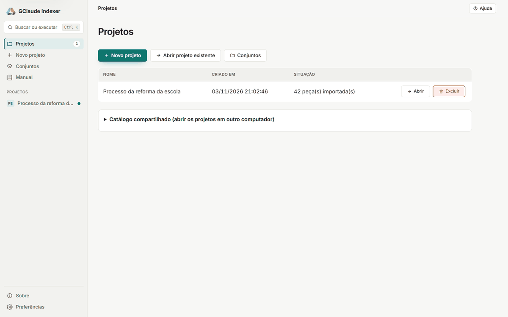
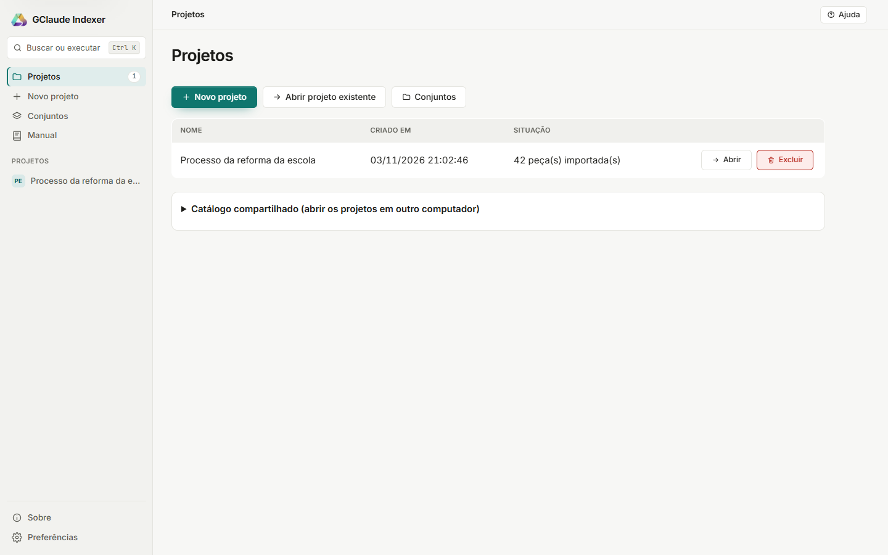
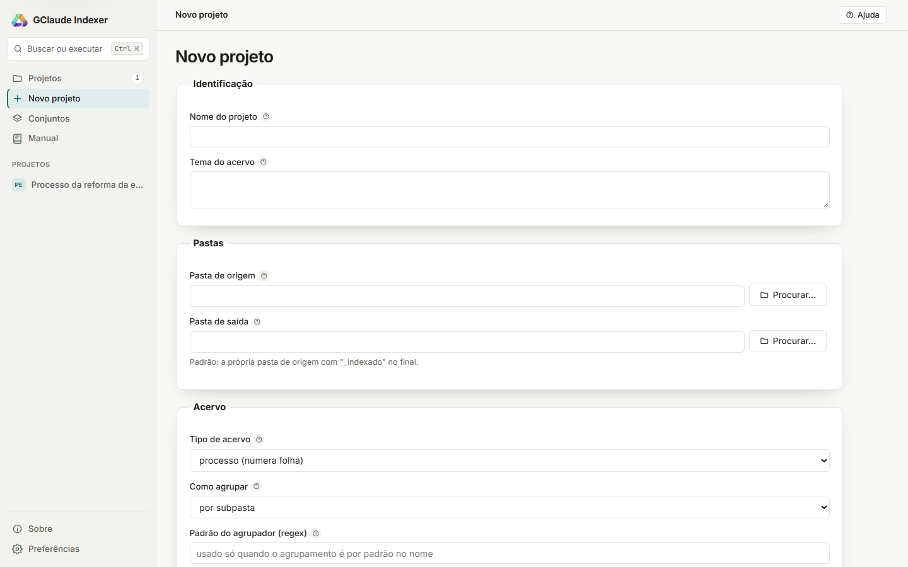
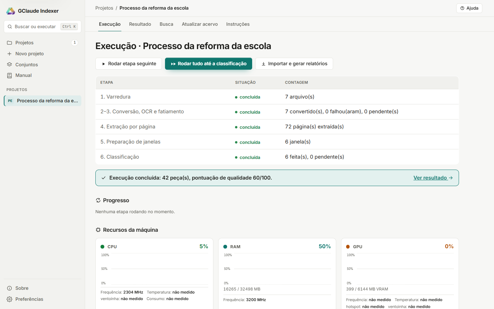
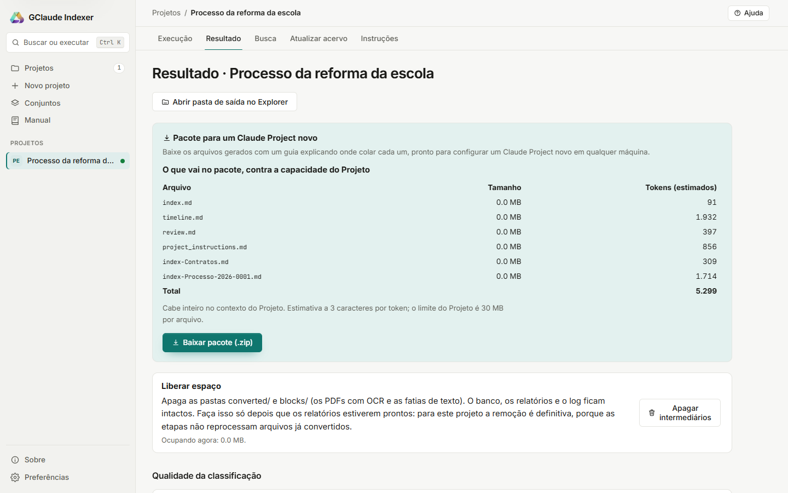
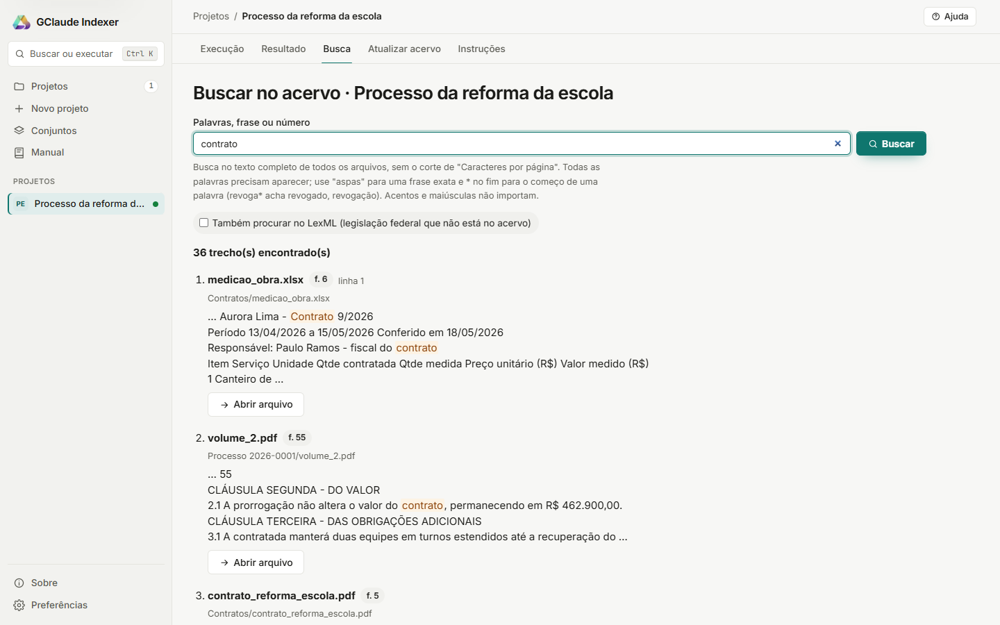
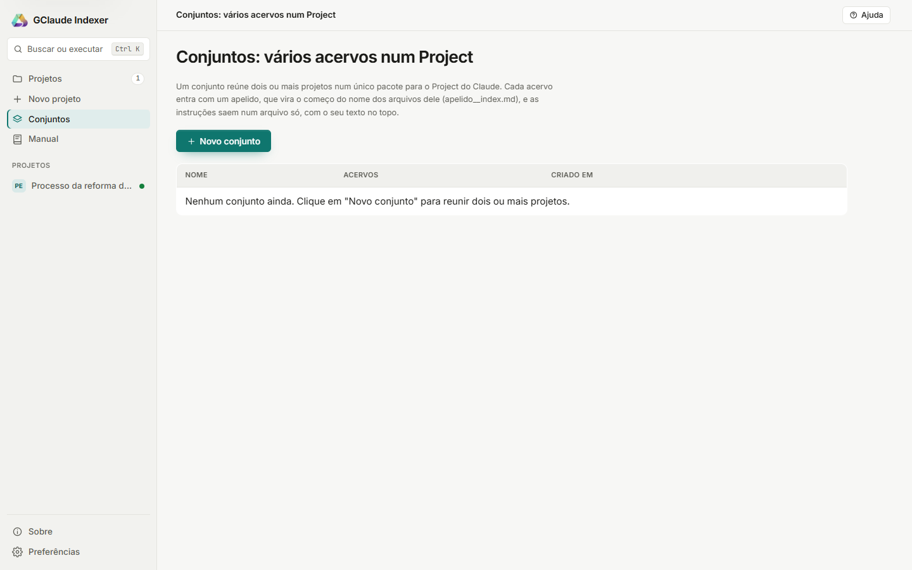
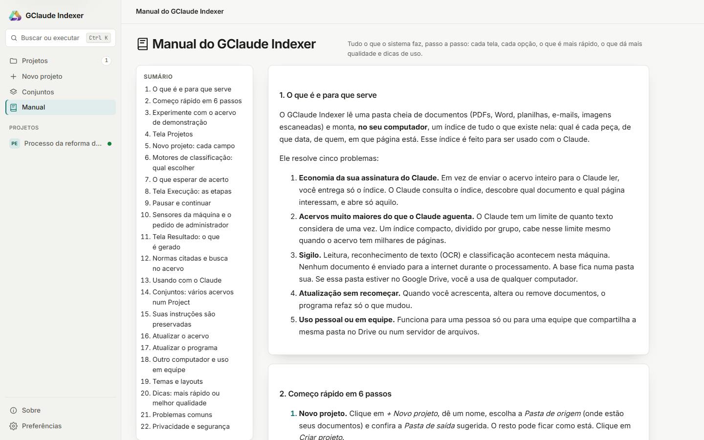

**Leia no seu idioma:** Português (Brasil), você está aqui · **[English](../README.md)** · **[Español](README.es.md)**

# GClaude Indexer

 

O GClaude Indexer lê uma pasta cheia de documentos no seu computador com Windows (PDFs, digitalizações, Word, Excel, e-mails) e monta um índice pequeno de tudo o que há nela: o que é cada peça, de que data, de quem e em que página está. Você entrega ao Claude só esse índice. Nada sai do seu computador enquanto o acervo é lido.

*Um passeio pelo layout Área de trabalho (1.10.0): os projetos na barra lateral, as abas de um projeto, a paleta de comandos (Ctrl+K) levando à busca e o tema Estúdio escuro.*

## Três pessoas que usam

**Uma advogada com um processo de 3.000 páginas.** Ela pergunta ao Claude "quando o laudo pericial foi juntado?". O Claude procura no índice, acha a peça, a folha e o arquivo, e abre só aquele documento. Sem o índice, ela teria que mandar as 3.000 páginas, e o Claude não aceita tanto de uma vez.

**Um servidor que cuida de processos administrativos.** A pasta cresce toda semana. Ele abre o programa, vê o aviso "14 novos, 3 alterados, 1 removido", confirma, e só essa parte é relida. O índice continua em dia e as conversas antigas com o Claude continuam valendo, a menos que um documento tenha entrado ou saído do meio do processo e mudado a numeração das folhas seguintes.

**Um escritório com três acervos.** Contratos, atas e correspondência vivem em projetos separados. Na tela Conjuntos, os três viram um pacote só, e um único Claude Project responde "em qual acervo está o aditivo de 2019?" e vai direto ao arquivo certo.

## O que você recebe

Alguns arquivos de texto pequenos na pasta de saída que você escolheu:

- `index.md`: o sumário, com um índice por grupo de documentos ao lado (`index-<grupo>.md`). Cada peça com tipo, data, autor, arquivo e página.
- `timeline.md`: as peças em ordem de data.
- `normas-citadas.md`: as leis e demais atos citados no acervo, com link para o texto de cada um.
- `review.md`: o que foi lido, o que falhou e o que foi removido da pasta.
- `project_instructions.md`: as instruções prontas para colar no Claude Project, a área do claude.ai que guarda instruções e arquivos para todas as conversas sobre um mesmo assunto.
- `buscar.bat`: a busca por tema para quem usa o Claude Code, a versão do Claude que roda numa janela de comandos do seu computador e lê os arquivos direto do disco.

E um pacote `.zip` com os arquivos de índice, medido antes de baixar: o programa mostra quantos tokens o pacote vai ocupar no Project e avisa quando um arquivo ficaria grande demais. Token é a medida de texto do Claude: três ou quatro letras, em média.

*Projetos: todos os acervos que este computador conhece.*

*Novo projeto: em geral basta o nome e a pasta de origem; o resto o programa propõe a partir do que encontra na pasta.*

*Execução: as etapas com progresso, o log em linguagem simples e os sensores de CPU, memória e placa de vídeo.*

*Resultado: nota de qualidade, pendências, prévia de cada arquivo e o pacote para o Claude com o orçamento de tokens.*

*Buscar no acervo: o termo, o arquivo, a página e o trecho; a consulta ao LexML é opcional.*

*Conjuntos: vários acervos num único Claude Project.*

*Manual: cada tela e cada opção explicadas dentro do programa.*

## O que você precisa ter

- Windows 10 ou 11.
- Alguns gigabytes livres em disco.
- Não precisa instalar nada antes. O instalador traz o Python, o OCR (Tesseract e Ghostscript, que leem páginas digitalizadas), o Ollama, que é o programa que roda o modelo local, e o próprio modelo; o que é opcional, ele mostra numa lista antes de baixar. A internet só é usada nessa hora.
- Uma placa de vídeo com 6 GB ou mais deixa o modelo local bem mais rápido. Sem placa, ele roda devagar na memória comum, e o motor de regras faz o serviço em segundos.

O programa classifica as peças de dois jeitos. O motor de regras reconhece cada peça por padrões do texto, como os títulos das peças, e termina em segundos. O modelo local é um programa de inteligência artificial que lê cada trecho, acerta mais a data e o autor, e demora mais. A opção padrão, Automático, usa o modelo local quando o computador aguenta e as regras quando não.

Para instalar, baixe o `GClaude-Indexer-Setup-1.10.2.exe` na [versão mais recente](https://github.com/alexccastilho/gclaude-indexer/releases/latest) e dê dois cliques. O Windows vai mostrar um aviso do SmartScreen, porque o instalador não tem assinatura digital paga: clique em "Mais informações" e depois em "Executar assim mesmo". Na tela Dependências, o instalador lista o que vai baixar e instalar junto; deixe tudo marcado. O maior item é o modelo local, com cerca de 3 GB, baixado uma vez só. O item do leitor de temperatura da CPU pede permissão de administrador do Windows; pode aceitar. Ao terminar, o programa abre uma página no seu navegador, no endereço `http://127.0.0.1:8000`, e o atalho na área de trabalho faz o mesmo nas próximas vezes. Para atualizar, instale a versão nova por cima; os seus projetos ficam onde estão. Para desinstalar, use Configurações > Aplicativos: ele pergunta o que tirar e nunca apaga os seus projetos.

Quem não pode instalar programas na máquina, ou quer rodar a partir do código, tem o caminho completo em [docs/TECHNICAL.pt-BR.md](TECHNICAL.pt-BR.md).

## Dez minutos para experimentar

Não precisa de um acervo próprio. A pasta `demo/acervo` do repositório é um acervo pequeno e inteiramente inventado: 72 páginas e 41 peças, com dois volumes de um processo em PDF, um contrato, um memorando em Word, uma planilha, um ofício digitalizado e um e-mail. O arquivo `demo/gabarito.csv` diz o que cada página é. O instalador não traz essa pasta: na página do projeto no GitHub, clique no botão verde **Code**, depois em **Download ZIP**, e descompacte o arquivo numa pasta sua.

1. Abra o programa e clique em **Novo projeto**. Dê um nome e aponte a pasta de origem para `demo/acervo`. Em **Extensões incluídas**, marque PDF, Word, Excel, imagens e e-mail. Clique em **Criar projeto**.
2. Na tela Execução, clique em **Rodar tudo até a classificação**. Com o motor de regras leva segundos; com o modelo local, alguns minutos.
3. Quando terminar, clique em **Importar e gerar relatórios** e abra a tela **Resultado**.
4. Clique em **Baixar pacote (.zip)**. Em claude.ai, crie um Project, cole o conteúdo inteiro de `project_instructions.md` no campo de instruções e envie os outros arquivos como conhecimento do projeto. O `.zip` traz um guia passo a passo com essas etapas.
5. Pergunte ao Claude: "qual é o valor do contrato e quem assinou?". Ele acha a peça no índice e pede o arquivo original só se precisar do texto exato.

Em toda tela, o botão **Ajuda** resume a tela e o **?** ao lado de cada campo explica o campo.

## Quanto acerta

O índice é medido contra o gabarito do acervo de demonstração a cada versão que mexa no classificador, e um teste automático no GitHub repete a medição a cada mudança no código. Na última medição (02/11/2026), nenhuma página se perdeu em nenhum dos dois motores. O motor de regras encontrou 36 das 41 peças em 4 segundos e acertou o tipo de 94% delas, mas a data de só metade delas e o autor de só uma em cada cinco. O modelo local (`qwen3.5:9b`) levou 4 minutos, acertou a data de 89% e o autor de 84% das peças encontradas, e fatiou mais peças do que devia.

O que isso quer dizer na prática: toda página do acervo está no índice, mesmo quando o tipo ou a data saem errados, e o Claude confere o texto no documento original antes de responder; é assim que as instruções mandam. Os números completos, o que cada um significa e o que eles não dizem estão em [docs/QUALITY.pt-BR.md](QUALITY.pt-BR.md).

## Privacidade

- Os documentos são lidos, passam pelo OCR e são classificados só no seu computador. Durante o processamento, nenhum documento, página ou nome de arquivo é enviado pela rede. O modelo local conversa apenas com o Ollama da mesma máquina.
- O programa só escuta na sua própria máquina (`127.0.0.1`) e só aceita pedidos das próprias telas: um site aberto no navegador não consegue dar ordens a ele.
- A pasta de origem nunca é alterada. Tudo o que o programa produz vai para a pasta de saída.
- O banco do projeto (`project.db`) guarda o texto das páginas. Se o acervo tiver dados pessoais, proteja a pasta de saída como protegeria os documentos, inclusive no Google Drive.
- O conteúdo chega ao Claude só quando você envia: ao subir os arquivos do índice num Project, ao mandar um documento, ou ao escolher o motor opcional `claude_code`. A única consulta externa é a busca no LexML, que envia só o termo que você digitou: na tela, só com a caixa marcada; no `buscar.bat`, também quando nenhuma norma do acervo cita o termo.

## Vários acervos num Project

Cada projeto é um acervo. Quando a pergunta atravessa vários ("o que temos sobre o fornecedor X em contratos e em atas?"), a tela **Conjuntos** junta dois ou mais projetos num pacote só. Cada acervo ganha um apelido curto, cada arquivo leva o apelido no nome, e um único `project_instructions.md` diz ao Claude em qual acervo procurar cada coisa. O botão **Gravar na pasta** faz o mesmo para o Claude Code, com um `CLAUDE.md` que aponta para cada acervo. Um acervo cuja pasta não está acessível neste computador fica de fora, com o motivo na tela, e volta sozinho quando a pasta voltar.

## Legislação e busca

Páginas de leis, decretos e portarias salvas do site do Planalto são reconhecidas pela própria estrutura da página, sem modelo. Cada norma citada no acervo vira uma linha do `normas-citadas.md`, com o número, a data, a ementa, onde ela aparece e um link para o texto no LexML, o portal de legislação do Senado. O Claude não precisa do texto da lei dentro do Project: ele abre o link quando precisa.

A tela **Buscar no acervo** procura uma palavra ou expressão no texto de todas as páginas e mostra o arquivo, a página e o trecho. Uma caixa opcional consulta também o LexML para listar as normas que tratam do tema. Quem usa o Claude Code tem a mesma busca na linha de comando, pelo `buscar.bat` que fica na pasta de saída.

## Em equipe

Coloque a pasta de saída no Google Drive ou numa pasta de rede, e qualquer computador com acesso abre o mesmo projeto. Na tela Projetos, aponte o **Catálogo compartilhado** para uma pasta do Drive e todos os computadores passam a ver a mesma lista. Um projeto aberto fica travado para aquele computador; o outro é avisado. Ao trocar de computador, feche o programa no primeiro e espere o Drive terminar de sincronizar antes de abrir no segundo.

## Manual e ajuda

O menu **Manual**, no topo de qualquer tela, cobre cada tela e cada opção, o que é mais rápido e o que dá mais qualidade, como usar os resultados com o Claude e com o Claude Code, uso em equipe e problemas comuns. Está em português, inglês e espanhol.

Para quem instala e mantém: [docs/TECHNICAL.pt-BR.md](TECHNICAL.pt-BR.md) tem os requisitos em detalhe, a instalação sem o instalador, o que cada arquivo de saída contém, as variáveis que o instalador grava para o Ollama e a solução de problemas. O que mudou em cada versão está em [docs/CHANGELOG.pt-BR.md](CHANGELOG.pt-BR.md). Para contribuir, leia [docs/CONTRIBUTING.pt-BR.md](CONTRIBUTING.pt-BR.md); para relatar uma falha de segurança, [SECURITY.md](../SECURITY.md).

## Licença

O GClaude Indexer é licenciado sob a **GNU General Public License v3.0** (GPL-3.0); veja [LICENSE](../LICENSE). Você é livre para usar, estudar, modificar e redistribuir este software, inclusive comercialmente, desde que qualquer versão modificada que você distribuir também seja licenciada sob a GPL-3.0, com o código-fonte disponível. Não há garantia de nenhum tipo.
